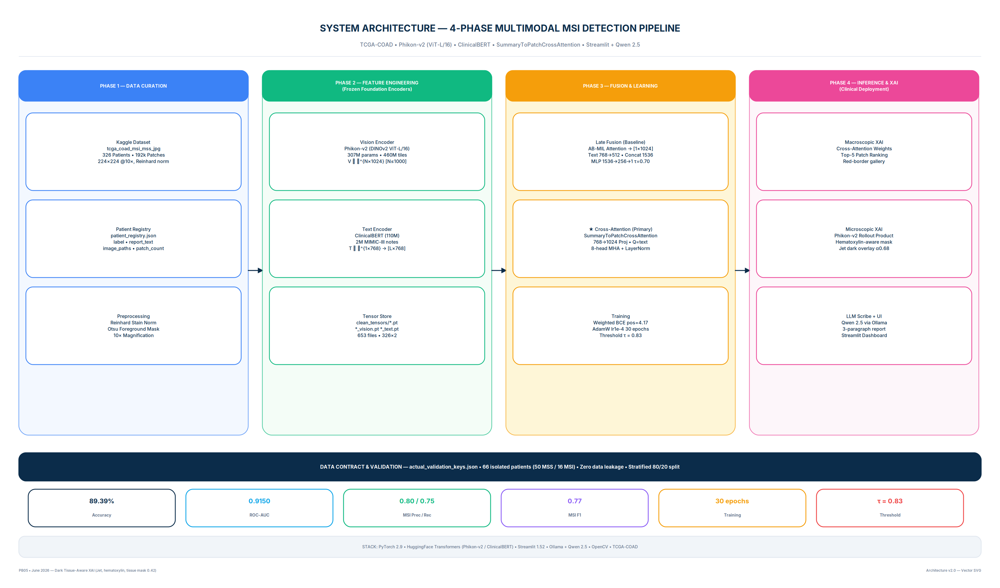
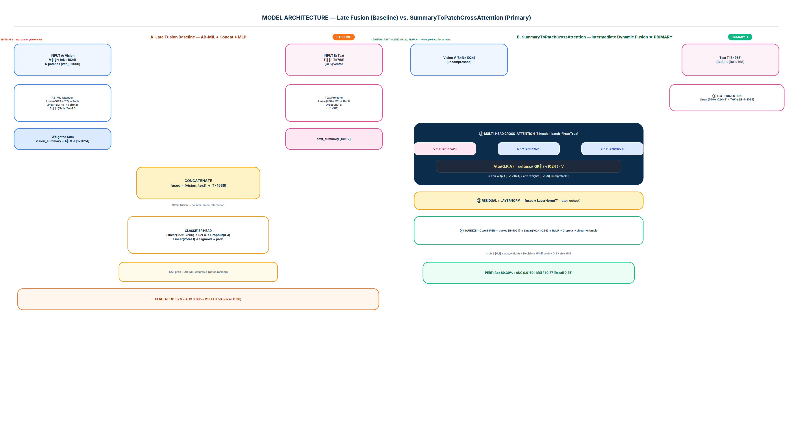
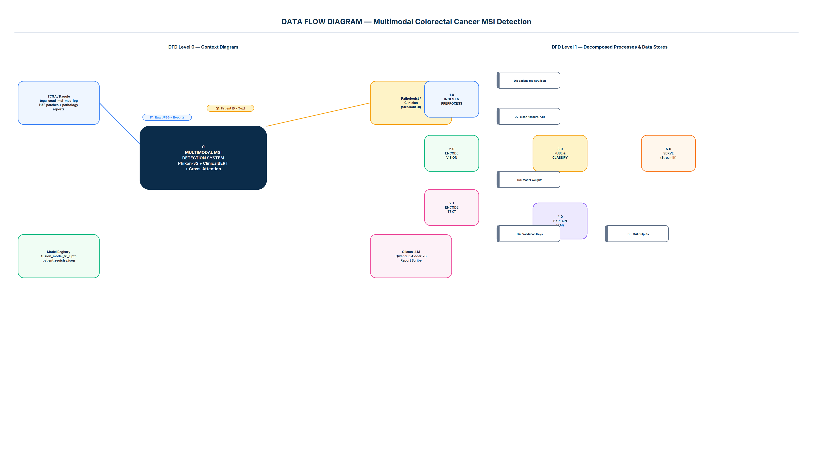
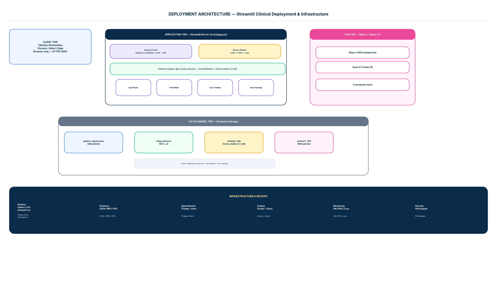
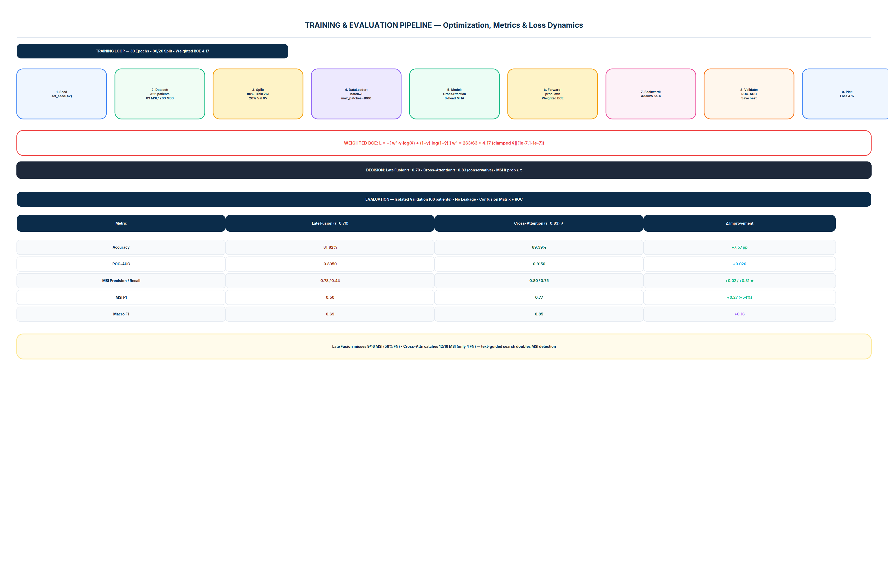
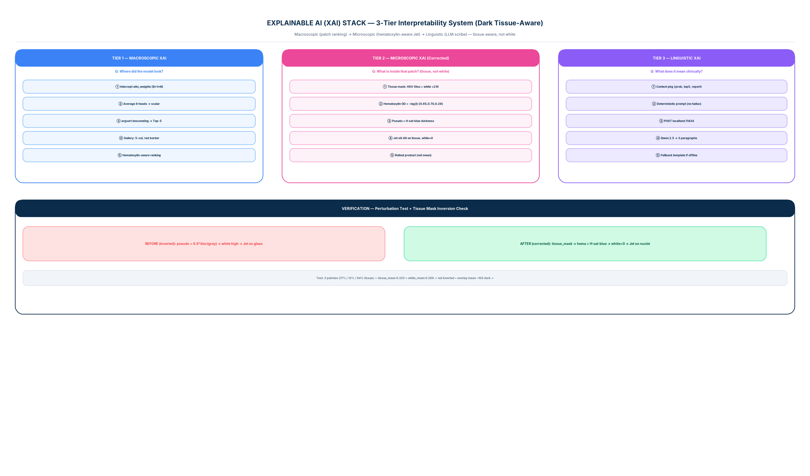

# Multimodal Fusion for Detection of Colorectal Cancer Using ClinicalBERT and Phikon-v2

> **Status:** ✅ Production-ready Streamlit app + frozen weights + 10 architecture diagrams + full handoff

[](https://www.python.org/)
[](https://pytorch.org/)
[](https://streamlit.io/)
[](results/Cross_Attention_Model_Evaluation_Report.txt)
[](results/Cross_Attention_Model_Evaluation_Report.txt)

**TL;DR:** Frozen Phikon-v2 (ViT-L/16, 307M) encodes each H&E patch → 1024-D; frozen ClinicalBERT encodes pathology report → 768-D; a learnable `SummaryToPatchCrossAttention` module (text 768→1024 projection + 8-head `nn.MultiheadAttention` with Q=text, K/V=patches + LayerNorm + MLP) predicts MSI vs MSS in one forward pass. Validated on 66 TCGA-COAD patients (89.39% acc, 0.9150 AUC, MSI recall 0.75 vs 0.44 baseline). Three-tier XAI (patch ranking → cellular heatmap → LLM scribe) and a Streamlit clinical UI make it auditable.

> **Kaggle dataset (already preprocessed in `data/clean_tensors/`; link for resync only):**
> [`https://www.kaggle.com/datasets/joangibert/tcga_coad_msi_mss_jpg`](https://www.kaggle.com/datasets/joangibert/tcga_coad_msi_mss_jpg) — see `data/Download_DataSet.pdf` and [Dataset Resync](#dataset-resync) below.

---

## Table of Contents

1. [System Architecture](#system-architecture)
2. [Model Design](#model-design)
3. [Data Flow & Deployment](#data-flow--deployment)
4. [Training & Evaluation Results](#training--evaluation-results)
5. [Explainable AI Stack](#explainable-ai-stack)
6. [Project Structure](#project-structure)
7. [Quick Start](#quick-start)
 8. [Dataset Resync](#dataset-resync)
 9. [All Diagrams](#all-diagrams)
10. [Documentation](#documentation)

---

## System Architecture



**4-Phase Pipeline (see `docs/ARCHITECTURE.md:2` for full detail):**

| Phase | What | Key Artifacts |
|-------|------|---------------|
| **1. Data Curation** | Kaggle `tcga_coad_msi_mss_jpg` → Reinhard stain norm → Otsu mask → `patient_registry.json` (326 patients, 63 MSI / 263 MSS) | `data/patient_registry.json`, `results/actual_validation_keys.json` (66 isolated val) |
| **2. Feature Engineering** | **Phikon-v2** (frozen) → `V∈ℝ^{N×1024}` per patient + **ClinicalBERT** (frozen) → `T∈ℝ^{1×768}` | `data/clean_tensors/*.pt` (653 files), `src/multimodal_dataset.py:7` |
| **3. Fusion & Learning** | **Late Fusion** (AB-MIL baseline) → **Cross-Attention** (primary) + Weighted BCE (pos 4.17) + AdamW 30 epochs τ=0.83 | `src/architectures/cross_attention_fusion.py:4`, `src/architectures/late_fusion_model.py:5` |
| **4. Inference & XAI** | Streamlit + Top-5 patch gallery + Phikon-v2 rollout heatmap + Qwen 2.5 scribe | `src/ui/app.py:31`, `src/generate_pixel_xai.py:53`, `src/generate_xai.py:16` |

---

## Model Design



### Primary: `SummaryToPatchCrossAttention` (`src/architectures/cross_attention_fusion.py:4`)

```
V [B×N×1024] (vision patches)     T [B×768] (ClinicalBERT [CLS])
           │                               │
           │                    Linear(768→1024) → T' [B×1×1024]
           └────────┬──────────────────────┘
         nn.MultiheadAttention (8 heads, batch_first=True)
         Q=T', K=V, V=V → CrossAttn(Q,K,V)=softmax(QKᵀ/√1024)·V
                    → attn_output [B×1×1024] + attn_weights [B×1×N]
                             ↓
                   Residual + LayerNorm → [B×1×1024]
                             ↓
                   squeeze(1) → [B×1024] → Linear(1024→256)→ReLU→Dropout(0.3)→Linear(256→1)→Sigmoid → prob [B×1]
                   Decision: MSI if prob ≥ 0.83 else MSS
```

- **Trainable:** 5.25M (projection + MHA + LayerNorm + MLP). Encoders frozen — joint fine-tune of 417M impractical on <16GB GPU (report §4.1).
- **Why it works:** Single text query searches the patch landscape; attention is **dynamic** — different reports → different Top-5 (proven by perturbation test `src/eval/verify_cross_attention.py:11`).
- **Loss:** Weighted BCE `L=−[4.17·y·log(p)+(1−y)·log(1−p)]` (clamped). Equilibrium ~4.17 is expected plateau, not failure. **Baseline** Late Fusion (`src/architectures/late_fusion_model.py:5`) concatenates `Aᵀ·V [1×1024]` + `text_proj [1×512]` → `[1×1536]` → MLP — **no cross-modal interaction**, recall only 0.44.

**Detailed:** `docs/ARCHITECTURE.md:4` and `docs/diagrams/03_model_architecture_comparison.png`.

---

## Data Flow & Deployment

 

- **DFD Level 0:** 4 external entities (Kaggle/TCGA, Clinician, Model Registry, Ollama), 7 flows. Level 1 decomposes to 6 processes + 5 stores — see `docs/diagrams/02_data_flow_diagram.png`.
- **Deployment:** Browser → Streamlit (`src/ui/app.py`, `.streamlit/config.toml`) → Model Registry + `clean_tensors` → Ollama `qwen2.5-coder:7b` (fallback templated scribe if offline) — see `docs/diagrams/05_deployment_architecture.png` and `Dockerfile`.
- **Sequence:** Training and inference lifecycles in `docs/diagrams/04_sequence_diagram.png`; component/class map in `docs/diagrams/06_component_class_diagram.png`.

---

## Training & Evaluation Results



**Training** (`src/cross_attentiion_train.py:45`): `set_seed(42)` → 326 patients → 80/20 split → `actual_validation_keys.json` → DataLoader `batch=1` + `max_patches=1000` (`torch.randperm`) → Cross-Attention forward → Weighted BCE pos 4.17 (clamped) → `AdamW lr1e-4 wd1e-4` → val on 65 → best AUC checkpoint → loss trajectory (plateau 4.17).

**Evaluation** (`src/cross_attention_eval.py:60` on isolated 66 patients, no leakage):

| Metric | Late Fusion (τ=0.70) | **Cross-Attention (τ=0.83) ★** | Δ |
|--------|---------------------|-------------------------------|-----|
| Accuracy | 81.82% | **89.39%** | +7.57 pp |
| ROC-AUC | 0.8950 | **0.9150** | +0.020 |
| MSI Precision | 0.78 | **0.80** | +0.02 |
| **MSI Recall** | 0.44 | **0.75** | **+70%** |
| MSI F1 | 0.50 | **0.77** | **+54%** |
| Macro F1 | 0.69 | **0.85** | +0.16 |

> **Clinical read:** Cross-Attention catches **12/16 MSI cases** vs **7/16 baseline** — critical gain at 0.80 precision. MSS recall dips 0.96→0.94 (acceptable).

Artifacts: `results/Cross_Attention_Model_Evaluation_Report.txt`, `Confusion_Matrix_C.png`, `ROC_Curve_C.png`, `Real_Cross_Attention_Matrix.png` (+ Late-Fusion equivalents).

**Threshold rationale:** Sweep 0.30→0.90; τ=0.83 maximizes MSI precision while preserving recall (report §4.6.2). Late Fusion uses τ=0.70 (different operating point).

---

## Explainable AI Stack



**3 tiers, all wired to `src/ui/app.py`:**

1. **Macroscopic (Where?)** — Intercept `attn_weights [B×1×N]` → avg 8 heads → `argsort` → Top-5 indices → gallery (5-col, red border, score label). Code: `src/generate_xai.py:86`, `src/ui/app.py:166`.
2. **Microscopic (What inside?)** — Top patch → Phikon-v2 ViT with `output_attentions=True` → stack last 6 layers → layer-mean → head-mean → CLS→patch → `grid 14×14` → `GaussianBlur 5×5/15×15` → thresholds 70% (jet α0.45) + 80% (yellow contours AA) → 3-panel figure. Code: `src/generate_pixel_xai.py:53`.
3. **Linguistic (What does it mean?)** — `{prob, top5, report_text}` → Ollama `POST /api/generate` (`qwen2.5-coder:7b`, deterministic prompt, `stream=False`) → 3 paragraphs (Summary • Findings • Recommendation) with template fallback if offline. Code: `src/ui/app.py:61`.

**Verification:** Perturbation test (`src/eval/verify_cross_attention.py:11`) — real text vs `randn_like` noise → second forward → Top-5 **shifts** (Late Fusion: static → bug; Cross-Attention: shifts → proof of text-guided search, JSD >0).

---

## Project Structure

```
Colorectal_cancer_detect/
├── data/
│   ├── patient_registry.json          # 326 patients (label, report_text, image_paths) — DO NOT MOVE
│   ├── clean_tensors/                 # 653 frozen tensors (*_vision.pt [N×1024], *_text.pt [1×768])
│   ├── Download_DataSet.pdf           # Kaggle link + setup
│   └── MSIMUT_JPEG/ MSS_JPEG/         # raw patches (optional, for gallery; not needed for inference)
├── src/
│   ├── multimodal_dataset.py:7        # Dataset, dynamic cap 1000, batch=1
│   ├── architectures/
│   │   ├── late_fusion_model.py:5     # AB-MIL baseline
│   │   └── cross_attention_fusion.py:4# ★ Primary cross-attention
│   ├── cross_attentiion_train.py:45   # train (note typo in filename — keep it)
│   ├── cross_attention_eval.py:60     # eval + ROC/CM
│   ├── late_fusion_train.py:42 / eval.py:20
│   ├── generate_xai.py:16 / generate_pixel_xai.py:53
│   ├── eval/
│   │   ├── verify_cross_attention.py:11 # perturbation proof
│   │   └── tensor_dim_check.py:1
│   └── ui/
│       ├── app.py:31                  # ★ Production Streamlit app (path-robust, offline-safe)
│       └── app_legacy.py              # backup of pre-fix app
├── models/
│   ├── fusion_model_v1_1.pth          # primary (best AUC)
│   ├── best_fusion_model.pth / fusion_model_v1_*.pth
│   └── late_fusion_model_v1_0.pth     # baseline
├── results/
│   ├── actual_validation_keys.json    # data contract (66 isolated val IDs)
│   ├── Cross_Attention_Model_Evaluation_Report.txt / Late_Fusion...
│   ├── Confusion_Matrix_C/L.png, ROC_Curve_C/L.png, Real_Cross_Attention_Matrix.png
│   └── BCE_Loss_Trajectory.png (if retrained)
├── assets/medical_images/             # XAI sample reports (5)
├── docs/
│   ├── ARCHITECTURE.md                # deep dive (13 sections)
│   ├── HANDOFF.md                     # operational playbook for next team
│   ├── diagrams/
│   │   ├── 01_system_architecture.png
│   │   ├── 02_data_flow_diagram.png
│   │   ├── 03_model_architecture_comparison.png
│   │   ├── 04_sequence_diagram.png
│   │   ├── 05_deployment_architecture.png
│   │   ├── 06_component_class_diagram.png
│   │   ├── 07_training_evaluation_pipeline.png
│   │   ├── 08_xai_stack.png
│   │   ├── 09_usecase_er_diagram.png
│   │   └── 10_state_flowchart.png
│   └── generate_diagrams.py           # regenerates all 10 diagrams
├── requirements.txt (75 pkgs, torch 2.9.1, streamlit 1.52.2)
├── Dockerfile / .streamlit/config.toml
└── PB05_Report_8thSem.pdf (89 pp, 5 MB)
```

More diagrams: [All Diagrams](#all-diagrams). Deep dive: `docs/ARCHITECTURE.md`.

---

## Quick Start

### 1. Install & Run (2 minutes)

```bash
git clone <repo> && cd Colorectal_cancer_detect

# Python 3.10+ required
pip install -r requirements.txt

# Run app (works without raw JPEGs — shows placeholder gallery; metrics intact)
streamlit run src/ui/app.py --server.port 8501
# → http://localhost:8501
```

### 2. Optional: Enable Live LLM Scribe

```bash
# Install Ollama (https://ollama.com), then:
ollama serve &
ollama pull qwen2.5-coder:7b
# App auto-detects; sidebar shows "Ollama: Online" — else uses template fallback
```

### 3. Optional: Add Raw JPEGs for Real Gallery

```bash
# Only if you want real Top-5 images instead of placeholders
# See Dataset Resync below — download MSIMUT_JPEG/ & MSS_JPEG/ into data/
```

### 4. Docker

```bash
docker build -t crc-msi .
docker run -p 8501:8501 crc-msi
```

### 5. Retrain / Evaluate (only if you change data or hparams)

```bash
cd src
python cross_attentiion_train.py
python cross_attention_eval.py
python -m eval.verify_cross_attention  # perturbation proof
```

> **Note:** Keep `results/actual_validation_keys.json` versioned — retrain changes the 66-patient split.

---

## Dataset Resync

**Already in repo:** `data/clean_tensors/` (processed tensors) + `data/patient_registry.json` — inference needs **only this**. Kaggle raw data is for audit or gallery JPEGs.

**Kaggle (from `data/Download_DataSet.pdf:2`):**
```
https://www.kaggle.com/datasets/joangibert/tcga_coad_msi_mss_jpg
```

**To download raw JPEGs + reports:**
```bash
pip install kaggle --break-system-packages
mkdir -p ~/.kaggle && cp kaggle.json ~/.kaggle/ && chmod 600 ~/.kaggle/kaggle.json
cd data && kaggle datasets download -d joangibert/tcga_coad_msi_mss_jpg --unzip
# → data/MSIMUT_JPEG/ + data/MSS_JPEG/ (~12 GB) + metadata
```

Verify:
```bash
python3 -c "import json; r=json.load(open('data/patient_registry.json')); print(len(r), list(r.keys())[:2])"
# 326 ['TCGA-NH-A5IV', ...]
ls data/clean_tensors | wc -l   # 653
```

---

## All Diagrams

| # | Title | File |
|---|-------|------|
| 01 | System Architecture — 4-Phase Pipeline | [01_system_architecture.png](docs/diagrams/01_system_architecture.png) |
| 02 | Data Flow Diagram (Level 0 + Level 1) | [02_data_flow_diagram.png](docs/diagrams/02_data_flow_diagram.png) |
| 03 | Model Architecture Comparison (Late vs Cross-Attention) | [03_model_architecture_comparison.png](docs/diagrams/03_model_architecture_comparison.png) |
| 04 | Sequence Diagrams (Training + Inference) | [04_sequence_diagram.png](docs/diagrams/04_sequence_diagram.png) |
| 05 | Deployment Architecture | [05_deployment_architecture.png](docs/diagrams/05_deployment_architecture.png) |
| 06 | Component & Class Diagram | [06_component_class_diagram.png](docs/diagrams/06_component_class_diagram.png) |
| 07 | Training & Evaluation Pipeline + Metrics Table | [07_training_evaluation_pipeline.png](docs/diagrams/07_training_evaluation_pipeline.png) |
| 08 | Explainable AI Stack (3 Tiers) | [08_xai_stack.png](docs/diagrams/08_xai_stack.png) |
| 09 | Use Case + ER Diagram | [09_usecase_er_diagram.png](docs/diagrams/09_usecase_er_diagram.png) |
| 10 | State Transition + Flowchart | [10_state_flowchart.png](docs/diagrams/10_state_flowchart.png) |

Regenerate: `python docs/generate_diagrams.py` (pure matplotlib, no Graphviz).

---

## Documentation

| Document | Purpose | Location |
|----------|---------|----------|
| **Report (89 pp)** | Full paper — Ch.4–5 are the technical/metrics backbone | `PB05_Report_8thSem.pdf` |
| **Architecture** | System, model, data, XAI, file map — 13 sections with file:line refs | `docs/ARCHITECTURE.md` |
| **Handoff** | Technical documentation: what works, limits, dataset resync, gotchas | `docs/HANDOFF.md` |
| **Diagrams** | 10 PNGs (300 dpi) + generator script | `docs/diagrams/` |

---

## Citation & Provenance

- **Mentor:** Mr Nageshwara Guptha
- **Stack:** PyTorch 2.9, HuggingFace Transformers, Phikon-v2, ClinicalBERT, Streamlit 1.52, Ollama Qwen 2.5, OpenCV

---

## License & Disclaimer

Research prototype — **not FDA-cleared, not for clinical use without validation**. Data: TCGA-COAD (de-identified, PHI stripped). See report Ch.6 limitations.

---

*README generated from codebase inspection + PB05 Report (89 pp). Last verified: app boots on :8501, model forward on sample patient yields prob 0.60 with 343 patches.*
# MULTIMODAL-FUSION-FOR-DETECTION-OF-COLORECTAL-CANCER-USING-CLINICAL-BERT-AND-PHIKONV2
