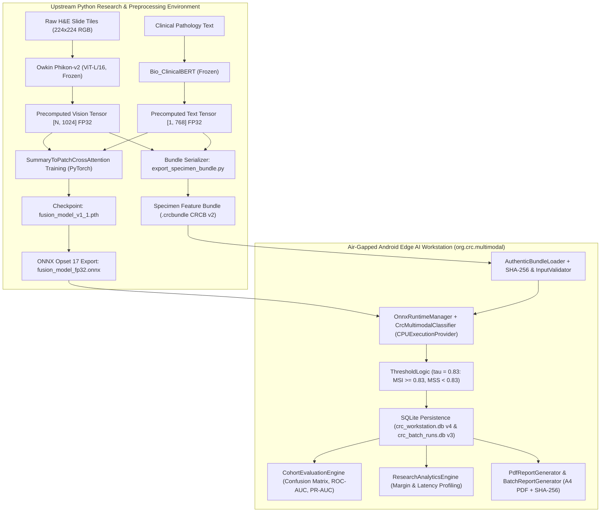
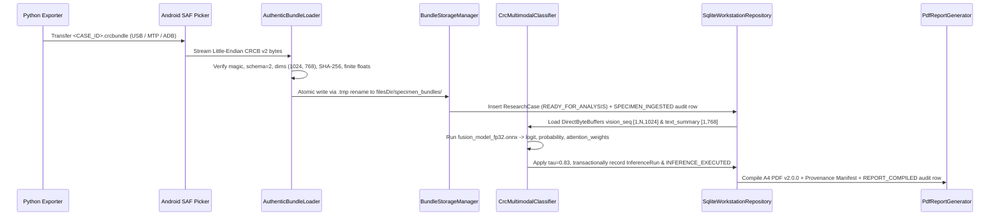

# EdgeCRC-AI: Multimodal Fusion for Colorectal Cancer MSI/MSS Research

**Cross-Attention Fusion of Phikon-v2 Histopathology and Bio_ClinicalBERT Clinical Text with Offline Android ONNX Runtime Edge Workstation**

[](android/build.gradle.kts)
[](android/app/build.gradle.kts)
[](android/app/build.gradle.kts)
[](requirements.txt)
[](requirements.txt)
[](android/app/src/main/java/org/crc/multimodal/inference/ThresholdLogic.kt)

**EdgeCRC-AI** is an end-to-end multimodal deep learning research and offline Android edge-deployment platform for investigating **Microsatellite Instability (`MSI`) versus Microsatellite Stability (`MSS`)** in Colorectal Cancer (`CRC`) specimens from the de-identified **TCGA-COAD** cohort. It pairs a Python model training, explainability, and ONNX export pipeline with a zero-permission, air-gapped native **Android Research Workstation** (`org.crc.multimodal`) backed by **ONNX Runtime Android 1.18.0** and local **SQLite** persistence.

> [!CAUTION]
> **FOR INVESTIGATIONAL RESEARCH USE ONLY.** EdgeCRC-AI is an academic computational pathology prototype and has **not** been cleared, certified, or approved by the FDA, EMA, CDSCO, or any regulatory authority for clinical diagnosis, patient triage, or therapeutic decision-making.

---

## Table of Contents

1. [Project Overview](#1-project-overview)
2. [Problem Statement and Motivation](#2-problem-statement-and-motivation)
3. [Project Objectives](#3-project-objectives)
4. [Key Features](#4-key-features)
5. [System Architecture Overview](#5-system-architecture-overview)
6. [End-to-End Data Flow](#6-end-to-end-data-flow)
7. [Multimodal Input Architecture and Tensor Specifications](#7-multimodal-input-architecture-and-tensor-specifications)
8. [Feature-Bundle Formats and Import Workflow](#8-feature-bundle-formats-and-import-workflow)
9. [Cross-Attention Fusion Architecture](#9-cross-attention-fusion-architecture)
10. [ONNX Export and Android Inference Architecture](#10-onnx-export-and-android-inference-architecture)
11. [Classification Logic and Decision Threshold](#11-classification-logic-and-decision-threshold)
12. [Android Application Modules and UI Screens](#12-android-application-modules-and-ui-screens)
13. [SQLite Database Architecture and Verified Schema](#13-sqlite-database-architecture-and-verified-schema)
14. [Batch Specimen Analysis Workflow](#14-batch-specimen-analysis-workflow)
15. [Cohort Evaluation Methodology and Metrics](#15-cohort-evaluation-methodology-and-metrics)
16. [Reporting and Research Analytics](#16-reporting-and-research-analytics)
17. [Technology Stack](#17-technology-stack)
18. [Repository Directory Structure](#18-repository-directory-structure)
19. [Prerequisites and Setup Instructions](#19-prerequisites-and-setup-instructions)
20. [Android Build and Deployment Guide](#20-android-build-and-deployment-guide)
21. [Workstation Usage Guide](#21-workstation-usage-guide)
22. [Configuration and Model Asset Contract](#22-configuration-and-model-asset-contract)
23. [Error Handling and Troubleshooting](#23-error-handling-and-troubleshooting)
24. [Testing Instructions and Coverage](#24-testing-instructions-and-coverage)
25. [Performance Gates and Device Considerations](#25-performance-gates-and-device-considerations)
26. [Security, Privacy, and Provenance Governance](#26-security-privacy-and-provenance-governance)
27. [Known Limitations and Source-Verified Nuances](#27-known-limitations-and-source-verified-nuances)
28. [Proposed Future Improvements](#28-proposed-future-improvements)
29. [Visual Diagrams and Optional Screenshots](#29-visual-diagrams-and-optional-screenshots)
30. [Research-Use and Medical Disclaimer](#30-research-use-and-medical-disclaimer)
31. [Author](#31-author)
32. [Acknowledgements and References](#32-acknowledgements-and-references)
33. [Licensing, Model Governance, and Attribution](#33-licensing-model-governance-and-attribution)

---

## 1. Project Overview

EdgeCRC-AI addresses multimodal biomarker prediction in colorectal adenocarcinoma by combining **patch-level histopathology embeddings** with **clinical pathology report embeddings** inside a lightweight **Text-to-Patch Cross-Attention Fusion Network** (`SummaryToPatchCrossAttention`).

The repository comprises two tightly verified subsystems that share a frozen mathematical contract:

1. **Upstream Python Research, Explainability & Export Pipeline (`src/`, `tools/`, `models/`):**
   - Trains and evaluates the `SummaryToPatchCrossAttention` fusion head (`5.25M` trainable parameters) over precomputed **Owkin Phikon-v2** (`[1, N, 1024]`) vision patch embeddings and **Bio_ClinicalBERT** (`[1, 768]`) clinical summary embeddings across `326` TCGA-COAD cases (`66` locked holdout validation cases).
   - Provides three-tier Explainable AI (`XAI`) utilities (cross-attention patch ranking, DINOv2 ViT self-attention rollout heatmaps, and an optional local Ollama clinical scribe) plus an interactive Streamlit desktop dashboard (`src/ui/app.py`).
   - Exports the trained PyTorch checkpoint (`models/fusion_model_v1_1.pth`) into an opset-17 single-precision ONNX graph (`models/fusion_model_fp32.onnx`, `21,015,452` bytes) and packages upstream specimen tensors into cryptographically hashed `.crcbundle` files (`tools/export_specimen_bundle.py`).

2. **Offline Android Edge AI Research Workstation (`android/`):**
   - A native Kotlin + Android Views (`Material Components`) mobile application (`org.crc.multimodal`) that embeds `fusion_model_fp32.onnx` directly inside APK assets and executes 100% local inference via **ONNX Runtime Android (`CPUExecutionProvider`)**.
   - Declares **zero Android permissions** (no `INTERNET` permission), ingests verified `.crcbundle` / `.npy` precomputed feature bundles, manages specimen records and audit trails in local **SQLite** databases, runs single-case and sequential batch evaluations (with automatic uncapped Protocol 2 routing for large slides), benchmarks predictions against the 66-case TCGA holdout cohort, profiles decision margins, and compiles multi-page **A4 PDF research reports** on-device.

> [!IMPORTANT]
> **Clear Architectural Boundary (Encoder vs. Fusion Execution):** Foundation feature extraction (**Phikon-v2** ~`307M` parameters on raw H&E image tiles and **Bio_ClinicalBERT** ~`108.3M` parameters on raw clinical text) executes **upstream** on a Python workstation/GPU (`src/inference/`). The Android application **does not** run Phikon-v2 or ClinicalBERT on raw Whole Slide Images or raw pathology text; it consumes **precomputed Float32 feature tensors** (`[1, N, 1024]` and `[1, 768]`) and executes the exported **cross-attention fusion model** locally via ONNX Runtime.

---

## 2. Problem Statement and Motivation

Approximately 15% of colorectal carcinomas exhibit **Microsatellite Instability (`MSI`)** resulting from deficient DNA Mismatch Repair (`dMMR` across *MLH1*, *MSH2*, *MSH6*, or *PMS2*). Identifying MSI status is critical in oncology research because MSI-High tumors carry high neoantigen loads that respond strongly to immune checkpoint inhibitors while showing distinct prognostic profiles compared to **Microsatellite Stable (`MSS`)** tumors.

Conventional wet-lab assays—Immunohistochemistry (`IHC`), PCR fragment analysis, or Next-Generation Sequencing (`NGS`)—require specialized reagents, laboratory infrastructure, and turnaround time. Computational pathology seeks to prescreen MSI probability from routine H&E histology and pathology notes, yet faces three practical challenges:

1. **Unimodal Blind Spots & Static Late Fusion:** Purely image-based Multiple Instance Learning (`AB-MIL`) ignores clinical context (anatomic site, mucinous differentiation, tumor grade), while naive vector concatenation fails to let clinical text guide spatial attention across heterogeneous tissue tiles.
2. **Foundation Encoder Compute Bottleneck:** Running a 307M-parameter ViT-L/16 backbone over 500–3,000 patches requires tens of TFLOPs (~`61.56 TFLOPs` for 500 patches in FP32), making raw-slide encoding impractical on mobile CPUs, whereas the downstream cross-attention fusion head requires only `~20 MB` of weights and `< 50 ms` per specimen.
3. **Traceable, Offline Edge Evaluation:** Research teams need a portable, network-isolated workstation capable of deterministic inference, provenance verification, cohort metric validation, and structured PDF documentation without transmitting sensitive research artifacts over a network.

---

## 3. Project Objectives

1. **Dynamic Cross-Modal Reasoning:** Replace static concatenation (`MultimodalFusionNetwork`) with `SummaryToPatchCrossAttention`, projecting the `768`-D ClinicalBERT `[CLS]` summary into `1024`-D space as an attention Query over `N` Phikon-v2 patch embeddings.
2. **Lossless ONNX Graph Portability:** Export the trained PyTorch fusion network to ONNX (`opset 17`) with dynamic patch-sequence axes while maintaining bit-level numerical parity (`max probability diff < 3e-6`, `0` label flips across all `66` holdout cases).
3. **Cryptographically Verified Tensor Ingestion:** Standardize a Little-Endian binary container (`.crcbundle` `CRCB` v2) carrying specimen metadata, tensor dimensions, and per-modality SHA-256 digests with fail-closed validation against NaN/Inf values and byte truncation.
4. **Full-Lifecycle Offline Android Workstation:** Deliver a multi-screen Android application supporting individual case workflows, pathologist review notes, batch cohort processing, confusion-matrix/ROC-AUC/PR-AUC benchmarking, margin analytics, and native A4 PDF report generation backed by transactional SQLite storage.

---

## 4. Key Features

| Subsystem | Capability | Implementation Location | Status |
| :--- | :--- | :--- | :---: |
| **Fusion Model** | 8-head Text-to-Patch Cross-Attention (`SummaryToPatchCrossAttention`) | `src/architectures/cross_attention_fusion.py` | Verified |
| **ONNX Export** | Trace-safe `CrossAttentionExportWrapper` (opset 17, dynamic `num_patches`) | `src/eval/export_onnx.py` | Verified |
| **Bundle Exporter** | Lossless `.crcbundle` (`CRCB` v2), JSON v2.0, and `.npy` pair serializer | `tools/export_specimen_bundle.py` | Verified |
| **Desktop Web UI** | Interactive Streamlit dashboard + 3-tier XAI + optional Ollama scribe | `src/ui/app.py`, `src/generate_pixel_xai.py` | Verified |
| **Android Engine** | Async singleton ONNX session (`CPUExecutionProvider`, Direct `ByteBuffer`) | `android/app/src/main/java/org/crc/multimodal/inference/OnnxRuntimeManager.kt`, `CrcMultimodalClassifier.kt` | Verified |
| **Dual Protocols** | `PROTOCOL_1_CAPPED` (`1 <= N <= 1000`) & `PROTOCOL_2_UNCAPPED` (`N >= 1`) | `android/app/src/main/java/org/crc/multimodal/inference/InferenceProtocol.kt`, `InputValidator.kt` | Verified |
| **Bundle Ingestion** | On-device parser for `CRCB` v2, `CRCT` v1, JSON v2.0, and `.npy` v1/v2 pairs | `android/app/src/main/java/org/crc/multimodal/inference/AuthenticBundleLoader.kt`, `NpyTensorLoader.kt` | Verified |
| **Case Workstation** | Case creation, pre-inference review checklist, findings bar, review notes | `android/app/src/main/java/org/crc/multimodal/ui/fragments/` | Verified |
| **SQLite Storage** | Dual SQLite databases (`crc_workstation.db` v4 & `crc_batch_runs.db` v3) | `android/app/src/main/java/org/crc/multimodal/data/SqliteWorkstationRepository.kt`, `BatchRepository.kt` | Verified |
| **Batch Analysis** | Up to 100 bundles/run, auto Protocol 2 fallback, archive/delete, bulk PDF | `android/app/src/main/java/org/crc/multimodal/batch/BatchCoordinator.kt`, `BatchAnalysisFragment.kt` | Verified |
| **Cohort Benchmark** | 66-case TCGA holdout matching, 2x2 matrix, 7 metrics, ROC-AUC & PR-AUC | `android/app/src/main/java/org/crc/multimodal/evaluation/CohortEvaluationEngine.kt` | Verified |
| **Research Analytics** | Probability histogram, decision-margin brackets (`tau = 0.83`), explorer | `android/app/src/main/java/org/crc/multimodal/analytics/ResearchAnalyticsEngine.kt` | Verified |
| **PDF Reporting** | Native Android `PdfDocument` A4 reports (single-case v2.0.0 & batch) | `android/app/src/main/java/org/crc/multimodal/report/PdfReportGenerator.kt`, `BatchReportGenerator.kt` | Verified |
| **Security & Audit** | Zero manifest permissions, path/Zip-Slip guard, PII log redactor, audit DB | `android/app/src/main/java/org/crc/multimodal/security/SafeFileValidator.kt`, `SensitiveLogRedactor.kt` | Verified |

---

## 5. System Architecture Overview



---

## 6. End-to-End Data Flow



---

## 7. Multimodal Input Architecture and Tensor Specifications

The fusion model requires **both** modalities simultaneously and fails closed if either modality is missing, empty, or contains non-finite values (`NaN`, `+Infinity`, `-Infinity`).

| Modality | ONNX Input Name | Tensor Shape | Data Type | Endianness (Serialized) | Upstream Source Encoder | Semantic Meaning |
| :--- | :--- | :--- | :--- | :--- | :--- | :--- |
| **Vision** | `vision_seq` | `[1, N, 1024]` | `Float32` | Little-Endian (`<f4`) | `owkin/phikon-v2` (DINOv2 ViT-L/16) | Sequence of `N` tissue-patch `[CLS]` embeddings (`1024` features per `224x224` patch) |
| **Clinical Text** | `text_summary` | `[1, 768]` | `Float32` | Little-Endian (`<f4`) | `emilyalsentzer/Bio_ClinicalBERT` | Pooled `[CLS]` token representation (`max_length=512` WordPiece tokens) of pathology summary |

### Modality Details

1. **Vision Tensor (`[1, N, 1024]`):**
   - `1` is the single-specimen batch dimension enforced during sequential edge evaluation.
   - `N` (`num_patches`) is the dynamic tissue-patch count for a specimen (`N >= 1`). Under `PROTOCOL_1_CAPPED`, `1 <= N <= 1000`; under `PROTOCOL_2_UNCAPPED`, `N >= 1` is uncapped up to `SafeFileValidator.MAX_ALLOWED_PATCH_COUNT` (`10,000` patches in file validation; `DirectByteBuffer` theoretical bound `524,287` patches).
   - `1024` is the Phikon-v2 hidden feature dimension (`InputValidator.VISION_FEATURE_DIM = 1024`).
   - Upstream extraction (`src/inference/image_preprocessing.py` and `vision_encoder.py`) performs tissue tiling, optional Reinhard stain normalization, and ViT-L/16 `[CLS]` extraction (`outputs.last_hidden_state[:, 0, :]`). None of these image-processing steps occur inside the Android app.

2. **Clinical-Text Tensor (`[1, 768]`):**
   - `768` is the Bio_ClinicalBERT hidden dimension (`InputValidator.TEXT_FEATURE_DIM = 768`).
   - Upstream extraction (`src/inference/report_encoder.py`) tokenizes clinical pathology narratives (`max_length=512`, `padding="max_length"`, `truncation=True`) and extracts `outputs.last_hidden_state[:, 0, :]`.
   - Any free-text notes typed into the Android `NewSpecimenFragment` (`Specimen Description` or `Research Context`) are persisted strictly as **human-readable case metadata** in SQLite—they are **not** tokenized or converted into `768`-D embeddings on the phone.

---

## 8. Feature-Bundle Formats and Import Workflow

`AuthenticBundleLoader.kt` (`android/app/src/main/java/org/crc/multimodal/inference/AuthenticBundleLoader.kt`) is a custom binary/JSON/NPY parser (**not** a ZIP archive). One bundle corresponds strictly to **one research specimen**.

### 8.1 Primary Binary Format: `.crcbundle` (`CRCB` Schema v2)

All integer headers and IEEE-754 `Float32` payloads are serialized in **Little-Endian** byte order (`ByteOrder.LITTLE_ENDIAN`). Note that the **text payload precedes the vision payload** in the binary stream:

| Byte Offset | Field | Type | Size (Bytes) | Validation Constraint |
| :--- | :--- | :--- | :--- | :--- |
| `0` | `magic` | ASCII | `4` | Exact bytes `'C', 'R', 'C', 'B'` (`0x43 0x52 0x43 0x42`) |
| `4` | `version` | `int32` LE | `4` | Must equal `2` (`CURRENT_SCHEMA_VERSION`) |
| `8` | `idLen` | `int32` LE | `4` | `1 <= idLen <= 256` |
| `12` | `specimenId` | UTF-8 | `idLen` | Trimmed string must be non-blank |
| `12 + idLen` | `descLen` | `int32` LE | `4` | `0 <= descLen <= 8192` |
| `16 + idLen` | `description` | UTF-8 | `descLen` | Optional specimen metadata description |
| `16 + idLen + descLen` | `patchCount` (`N`) | `int32` LE | `4` | `N > 0` |
| `20 + idLen + descLen` | `visionDim` | `int32` LE | `4` | Must equal `1024` |
| `24 + idLen + descLen` | `textDim` | `int32` LE | `4` | Must equal `768` |
| `28 + idLen + descLen` | `dataType` | `int32` LE | `4` | Must equal `1` (`Float32` Little-Endian) |
| `32 + idLen + descLen` | `visionSha256` | Raw Digest | `32` | 32-byte binary SHA-256 of `visionBytes` |
| `64 + idLen + descLen` | `textSha256` | Raw Digest | `32` | 32-byte binary SHA-256 of `textBytes` |
| `96 + idLen + descLen` | `textBytes` | `float32[]` LE | `3,072` | `768 * 4` bytes; all values finite |
| `3168 + idLen + descLen` | `visionBytes` | `float32[]` LE | `N * 4,096` | `N * 1024 * 4` bytes; all values finite; exact EOF (`remaining == 0`) |

### 8.2 Additional Supported Formats

1. **`CRCT` Binary v1 (Legacy Benchmark `.bin` Format):**
   - Magic `'C', 'R', 'C', 'T'`, `version = 1`, containing `specimenId`, `patchCount`, `gtLabel`, `refLogit`, `refProb`, `refCall`, `3,072`-byte LE text tensor, and `N * 4,096`-byte LE vision tensor. Used by the 7 frozen parity benchmark assets in `android/app/src/main/assets/reference_tensors/`.
2. **Portable JSON Bundle (`.crcmanifest.json`, Schema v2.0):**
   - Leading `'{'` parsed by a zero-dependency recursive-descent parser (`AuthenticBundleLoader.JsonParser`). Supports `vision_tensor` (`[1, N, 1024]`) and `text_tensor` (`[1, 768]`) encoded via `data_base64` (LE Float32 bytes) or numeric `data` arrays. *(Note: SHA-256 strings in JSON bundles are recorded as metadata without cryptographic recomputation on load, whereas `CRCB` v2 binary bundles recompute and enforce SHA-256 digests.)*
3. **Paired NumPy Arrays (`_vision.npy` + `_text.npy`):**
   - `NpyTensorLoader.kt` parses NumPy `.npy` v1.0 and v2.0 files (`magic = \x93NUMPY`, `descr` in `{'<f4', '|f4', 'float32'}`, `fortran_order = False`), validates shapes (`[N, 1024]` / `[1, N, 1024]` and `[768]` / `[1, 768]`), computes SHA-256 digests, and converts the pair into a canonical `CRCB` v2 `.crcbundle` via `BundleStorageManager`.

### 8.3 Atomic Storage and Validation Rules

- Imported bundles are persisted by `BundleStorageManager` (`android/app/src/main/java/org/crc/multimodal/inference/BundleStorageManager.kt`) inside app-internal storage at `context.filesDir/specimen_bundles/<sanitized_id>.crcbundle` using a `.tmp` write-then-atomic-rename pattern protected by `SafeFileValidator.validateSafePath`.
- Corrupted headers, unsupported versions, dimension mismatches, SHA-256 mismatches, trailing garbage bytes, or `NaN`/`Inf` tensor elements immediately throw `IllegalArgumentException` and reject the bundle before inference.

---

## 9. Cross-Attention Fusion Architecture

Defined in `src/architectures/cross_attention_fusion.py` (`SummaryToPatchCrossAttention`), the trainable fusion head (`5,250,561` parameters) executes the following forward sequence:

1. **Text Projection (`nn.Linear(768, 1024)`):** Projects the clinical summary embedding $T \in \mathbb{R}^{B \times 1 \times 768}$ into the `1024`-D histological feature space to form the attention **Query** $Q \in \mathbb{R}^{B \times 1 \times 1024}$.
2. **Multi-Head Cross-Attention (`nn.MultiheadAttention(embed_dim=1024, num_heads=8, batch_first=True)`):** Uses $Q$ (clinical text) to attend over all $N$ patch embeddings acting as **Keys** $K \in \mathbb{R}^{B \times N \times 1024}$ and **Values** $V \in \mathbb{R}^{B \times N \times 1024}$ ($d_k = 128$ per head), yielding attended context $C \in \mathbb{R}^{B \times 1 \times 1024}$ and patch attention weights $A \in \mathbb{R}^{B \times 1 \times N}$.
3. **Residual Addition & Layer Normalization (`nn.LayerNorm(1024)`):** Computes $\text{LayerNorm}(Q + C)$ and squeezes the sequence axis to $[B, 1024]$.
4. **Classification MLP Head (`nn.Sequential`):**
   - `nn.Linear(1024, 256)` $\rightarrow$ `nn.ReLU()` $\rightarrow$ `nn.Dropout(0.3)` $\rightarrow$ `nn.Linear(256, 1)` (`logit`) $\rightarrow$ `nn.Sigmoid()` (`probability` $\in [0, 1]$).

### Architectural Comparison Against Baseline (`src/architectures/late_fusion_model.py`)

| Property | Late-Fusion Baseline (`MultimodalFusionNetwork`) | Primary Model (`SummaryToPatchCrossAttention`) |
| :--- | :--- | :--- |
| **Cross-Modal Mechanism** | Static vector concatenation after unimodal pooling | Dynamic 8-head Text-to-Patch Cross-Attention ($Q=\text{Text}, K=V=\text{Vision}$) |
| **Trainable Parameters** | `5,255,861` | `5,250,561` |
| **Operating Threshold ($\tau$)** | `0.70` | **`0.83`** |
| **Holdout Accuracy (66 cases)** | `81.82%` | **`89.39%`** (Protocol 1) |
| **Holdout MSI Recall (16 MSI)** | `43.75%` (`7 / 16`) | **`75.00%` (`12 / 16`)** |
| **Holdout MSI F1-Score** | `0.5600` | **`0.7742`** (Protocol 1) |

---

## 10. ONNX Export and Android Inference Architecture

### 10.1 Why Export Wrapper & ONNX Were Used

Line 48 of `src/architectures/cross_attention_fusion.py` contains an unused CPU NumPy conversion (`attn_weights[0].detach().cpu().numpy()`) that breaks TorchScript/ONNX tracing, and passing identical Python tensor references `key=vision_seq, value=vision_seq` causes TorchScript to bake static patch shapes into internal `Reshape` nodes. `CrossAttentionExportWrapper` (`src/eval/export_onnx.py`) cleanly bypasses the unused NumPy call and clones `value` during tracing (`opset_version = 17`) so `num_patches` remains genuinely dynamic (`N = 1` through `N = 4,305+`) with `0.0` numerical drift against the base PyTorch module.

### 10.2 Embedded Android Model Asset & Runtime Contract

- **Bundled Asset:** `android/app/src/main/assets/models/fusion_model_fp32.onnx` (kept uncompressed via `noCompress.addAll(listOf("onnx"))` in `android/app/build.gradle.kts`).
- **Exact File Size:** `21,015,452` bytes (`20.04 MiB`).
- **SHA-256 Digest:** `0402f6c522beac5733e30eeecad908927957b5d4164b6b896663f43ba3702d73` (verified at session startup by `OnnxRuntimeManager` and embedded in provenance manifests by `ProvenanceAuditManager`).
- **Runtime Dependency:** `com.microsoft.onnxruntime:onnxruntime-android:1.18.0`.
- **Session Configuration (`CrcMultimodalClassifier.kt`):**
  - Environment: `OrtEnvironment.getEnvironment("CrcClassifierEnv")`
  - Execution Provider: `CPUExecutionProvider` (local deterministic FP32 execution; no NNAPI/GPU delegate drift)
  - Threading & Optimization: `setIntraOpNumThreads(2)`, `OptLevel.ALL_OPT`
  - Memory Allocation: Native-order `ByteBuffer.allocateDirect(...)` mapped into `OnnxTensor` instances and deterministically closed in a `finally` block under `synchronized(executionLock)`.

| Direction | Tensor Name | Shape | ONNX Type | Kotlin Extraction & Validation |
| :--- | :--- | :--- | :--- | :--- |
| **Input 0** | `vision_seq` | `[1, N, 1024]` | `FLOAT` (FP32) | `DirectByteBuffer` (`N * 1024 * 4` bytes); finite check via `InputValidator` |
| **Input 1** | `text_summary` | `[1, 768]` | `FLOAT` (FP32) | `DirectByteBuffer` (`3,072` bytes); finite check via `InputValidator` |
| **Output 0** | `logit` | `[1, 1]` | `FLOAT` (FP32) | Pre-sigmoid scalar `Float`; checked finite |
| **Output 1** | `probability` | `[1, 1]` | `FLOAT` (FP32) | In-graph sigmoid scalar `Float`; checked finite and in `[0.0f, 1.0f]` |
| **Output 2** | `attention_weights` | `[1, 1, N]` | `FLOAT` (FP32) | Head-averaged patch attention `FloatArray(N)`; checked finite and `>= 0.0f` |

### 10.3 Dual Evaluation Protocols (`InferenceProtocol.kt`)

- **`PROTOCOL_1_CAPPED`:** Enforces `1 <= N <= 1000` patches. If `N > 1000`, `InputValidator` rejects execution rather than performing non-deterministic on-device random subsampling (all manifest-based patch capping happens upstream).
- **`PROTOCOL_2_UNCAPPED`:** Evaluates the complete uncapped patch sequence (`N >= 1`) using the dynamic `num_patches` axis of `fusion_model_fp32.onnx`.

---

## 11. Classification Logic and Decision Threshold

Verified in `ThresholdLogic.kt` (`android/app/src/main/java/org/crc/multimodal/inference/ThresholdLogic.kt`) and `MultimodalPredictor` (`src/inference/multimodal_predictor.py`):

- **Class `0` = `MSS`** (*Microsatellite Stable* — negative reference class)
- **Class `1` = `MSI`** (*Microsatellite Instability* — positive target class)
- **Frozen Operating Threshold:** $\tau = 0.83$ (`ThresholdLogic.OPERATING_THRESHOLD = 0.83f`)

$$\text{Predicted Class} = \begin{cases} 1 \ (\text{MSI}) & \text{if } P_{\text{MSI}} \ge 0.83 \\ 0 \ (\text{MSS}) & \text{if } P_{\text{MSI}} < 0.83 \end{cases}$$

**Why $\tau = 0.83$?** During training on the imbalanced TCGA-COAD cohort (`63` MSI vs. `263` MSS, positive BCE weight $w_{\text{pos}} \approx 4.17$), raw sigmoid probabilities are shifted upward toward the positive class. Calibrating the operating boundary at $\tau = 0.83$ suppresses false-positive calls (`94.0%` specificity, `80.0%` precision) while maintaining `75.0%` MSI sensitivity. The signed decision margin is recorded as `margin = probability - 0.83f`.

---

## 12. Android Application Modules and UI Screens

The Android UI is implemented using **Android Views (`Fragment` + XML layouts + Material Components `1.12.0` + custom `Canvas` view `ProbabilityThresholdBarView`)** hosted inside a single `MainActivity` (`WorkstationNavigationHost`) with a 4-tab `BottomNavigationView` (`Workspace`, `Cases`, `New Analysis`, `Settings`).

| # | Screen / Fragment | Toolbar Title | Primary Inputs & Controls | Outputs & Persistence | Source File |
| :-: | :--- | :--- | :--- | :--- | :--- |
| 1 | `WorkspaceFragment` | *CRC Multimodal Research Workstation* | Engine status card (tap to retry), workflow launch cards, seed reference cases | Case status counters, live `OnnxRuntimeState`, 4 recent cases | `ui/fragments/WorkspaceFragment.kt` |
| 2 | `NewSpecimenFragment` | *New Specimen Analysis* | Case ID, description, context, `.crcbundle` SAF picker, 2-step `.npy` pair picker | Validated `.crcbundle` in `filesDir/specimen_bundles/`, `cases` & `specimen_inputs` rows | `ui/fragments/NewSpecimenFragment.kt` |
| 3 | `SpecimenReviewFragment` | *Specimen Review* | Pre-inference checklist verification for vision, text, protocol, and ONNX engine | Fail-closed gate enabling/disabling *Configure & Run Inference* | `ui/fragments/SpecimenReviewFragment.kt` |
| 4 | `InferenceExecutionFragment` | *Inference Configuration* | Protocol toggle (`Protocol 1` vs `Protocol 2`), inline bundle import, *Run Inference* | Sequential background ONNX execution, parity check, `inference_runs` commit | `ui/fragments/InferenceExecutionFragment.kt` |
| 5 | `FindingsFragment` | *Analysis Findings* | Diagnostics expand/collapse, shortcuts to Review Notes and Research Report | MSI/MSS badge, probability, signed margin, `ProbabilityThresholdBarView`, latency | `ui/fragments/FindingsFragment.kt` |
| 6 | `ReportFragment` | *Research Report* | Preview PDF, Save PDF (SAF), Share PDF (`FileProvider`), Report History, Regenerate | Multi-page A4 PDF v2.0.0, text report, SHA-256 provenance, `report_history` rows | `ui/fragments/ReportFragment.kt` |
| 7 | `ReviewNotesFragment` | *Review Questions & Notes* | 5 note category chips, author label, note text, *Mark Under Review* / *Reviewed* | Categorized `review_notes` rows and updated `cases.status` | `ui/fragments/ReviewNotesFragment.kt` |
| 8 | `CasesFragment` | *Case Management* | Live search bar, 6 status filter chips, cyclic sort (*Newest*, *Oldest*, *Case ID*) | Filtered `CaseAdapter` list with count summary | `ui/fragments/CasesFragment.kt` |
| 9 | `CaseDetailsFragment` | *Case Details* | Run Inference, View Findings, Manage Notes, View Report, cascading Delete Case | Full specimen metadata and chronological `InferenceRun` history | `ui/fragments/CaseDetailsFragment.kt` |
| 10 | `BatchAnalysisFragment` | *Batch Specimen Analysis* | Multi-file `.crcbundle` picker, Execute/Cancel Batch, search/chips, bulk PDF/Archive/Delete | Sequential cohort execution, case sync, combined PDF/JSON/SHA-256 reports | `ui/fragments/BatchAnalysisFragment.kt` |
| 11 | `CohortEvaluationFragment` | *Cohort Evaluation* | *Load TCGA Labels* (`66` cases), *Clear*, search, TP/TN/FP/FN/Misclassified chips, sort | 2x2 confusion matrix, 7 metrics, ROC-AUC, PR-AUC, small-sample warning banner | `ui/fragments/CohortEvaluationFragment.kt` |
| 12 | `AnalyticsDashboardFragment` | *Research Analytics* | Search bar, 5 filter chips (incl. *Near Threshold*), cyclic sort | 6 probability buckets, 4 margin brackets, latency & patch distributions, explorer | `ui/fragments/AnalyticsDashboardFragment.kt` |
| 13 | `SettingsFragment` | *Settings & About* | System/Light/Dark theme toggle, Seed Reference Cases, Clear All Workstation Data | Live `AppCompatDelegate` night mode, frozen model specs, DB/audit counts | `ui/fragments/SettingsFragment.kt` |

> [!NOTE]
> **Completed vs. Placeholder Controls in `SettingsFragment`:** Theme switching, reference-case seeding, and workstation data clearing are fully functional. However, `res/layout/fragment_settings.xml` also renders an optional `BACKEND CONNECTION (OPTIONAL)` text field (`@+id/etRemoteEndpoint`, *"Remote Inference Server Base URL"*). Source inspection confirms this input field is an **unwired UI placeholder**—no Kotlin code reads it, and `AndroidManifest.xml` declares zero network permissions. All inference is strictly local.

---

## 13. SQLite Database Architecture and Verified Schema

The Android workstation persists research data across **two** local SQLite databases managed via `SQLiteOpenHelper` with synchronized access and explicit transactional cleanup:

1. **`crc_workstation.db` (Schema Version `4`)** — `SqliteWorkstationRepository.kt` (`8` tables)
2. **`crc_batch_runs.db` (Schema Version `3`)** — `BatchRepository.kt` (`2` tables)

### 13.1 Entity-Relationship Diagram

```mermaid
erDiagram
    CASES ||--o{ SPECIMEN_INPUTS : "has_inputs"
    CASES ||--o{ INFERENCE_RUNS : "records_runs"
    CASES ||--o{ REVIEW_NOTES : "has_notes"
    CASES ||--o| RESEARCH_REPORTS : "latest_text_report"
    CASES ||--o{ REPORT_HISTORY : "pdf_versions"
    BATCH_RUNS ||--o{ BATCH_ITEMS : "contains_items"

    CASES {
        int id PK
        text case_identifier UK
        text specimen_description
        text research_context
        text status
        int patch_count
        text protocol
        int created_at
        int updated_at
    }
    SPECIMEN_INPUTS {
        int id PK
        int case_id FK
        text input_type
        text local_uri
        text filename
        text validation_status
        int created_at
    }
    INFERENCE_RUNS {
        int id PK
        int case_id FK
        text model_identifier
        text inference_architecture
        text protocol
        int predicted_class
        text predicted_label
        real probability
        real logit
        real threshold
        real margin
        real latency_ms
        int num_patches
        text diagnostics_summary
        int execution_timestamp
        text status
    }
    REVIEW_NOTES {
        int id PK
        int case_id FK
        text category
        text author_label
        text content
        int created_at
        int updated_at
    }
    RESEARCH_REPORTS {
        int id PK
        int case_id FK_UK
        int inference_run_id
        int generated_at
        text report_content
        text findings_summary
    }
    REPORT_HISTORY {
        int id PK
        text report_id UK
        int case_id FK
        int inference_run_id
        text template_version
        int created_at
        text export_status
        text file_uri
        text file_path
        text model_version
        text sha256_hash
        text error_message
    }
    REFERENCE_LABELS {
        text specimen_id PK
        int ground_truth_label
        text ground_truth_class
        text cohort_id
        text source
        int imported_at
    }
    AUDIT_TRAIL {
        int id PK
        int event_timestamp
        text action_type
        text specimen_id
        text details
        text sha256_fingerprint
        text performed_by
    }
    BATCH_RUNS {
        text batch_id PK
        text title
        int created_at
        int updated_at
        text status
        text model_sha256
        text app_version
        text execution_provider
        real decision_threshold
        int total_duration_ms
    }
    BATCH_ITEMS {
        int id PK
        text batch_id FK
        text specimen_id
        text file_name
        int file_size_bytes
        text bundle_sha256
        text vision_sha256
        text text_sha256
        int patch_count
        text status
        real logit
        real probability
        int predicted_class
        text predicted_label
        real threshold
        int inference_latency_ms
        text protocol
        text protocol_reason
        int is_archived
    }
```

### 13.2 Verified Table Specifications & Lifecycle Behavior

| Database | Table | Primary Key / Unique | Indexes | Purpose & Operational Behavior |
| :--- | :--- | :--- | :--- | :--- |
| `crc_workstation.db` | `cases` | `id` PK, `case_identifier` UNIQUE | `idx_cases_updated`, `idx_cases_status` | Master specimen registry; case-insensitive uniqueness enforced (`COLLATE NOCASE`). |
| `crc_workstation.db` | `specimen_inputs` | `id` PK | `idx_inputs_case(case_id)` | Tracks imported `.crcbundle` URI, filename, and validation state per case. |
| `crc_workstation.db` | `inference_runs` | `id` PK | `idx_runs_case(case_id)` | Immutable log of ONNX runs (`logit`, `probability`, `margin`, `latency_ms`, `protocol`). |
| `crc_workstation.db` | `review_notes` | `id` PK | `idx_notes_case(case_id)` | Pathologist notes across 5 categories; adding a note moves `ANALYZED` $\rightarrow$ `UNDER_REVIEW`. |
| `crc_workstation.db` | `research_reports` | `id` PK, `case_id` UNIQUE | — | Stores latest deterministic ASCII text report (`CONFLICT_REPLACE`). |
| `crc_workstation.db` | `report_history` | `id` PK, `report_id` UNIQUE | `idx_reports_case`, `idx_reports_uid` | Tracks generated PDF files; dynamically flags `MISSING_FILE` if deleted from disk. |
| `crc_workstation.db` | `reference_labels` | `specimen_id` PK | `idx_ref_cohort(cohort_id)` | Stores ground-truth labels (`0` = MSS, `1` = MSI) for offline cohort benchmarking. |
| `crc_workstation.db` | `audit_trail` | `id` PK | `idx_audit_time`, `idx_audit_specimen` | Append-only governance log recording 11 `AuditActionType` events with SHA-256 digests. |
| `crc_batch_runs.db` | `batch_runs` | `batch_id` PK | `idx_batch_created(created_at DESC)` | Header metadata, model digest, threshold, and duration for multi-specimen runs. |
| `crc_batch_runs.db` | `batch_items` | `id` PK | `idx_items_batch`, `idx_items_specimen` | Per-specimen parse/validation/inference telemetry, protocol routing reason, `is_archived`. |

- **Startup Crash Recovery:** On launch, `MainActivity` executes `recoverInterruptedCases()` (reverting orphan `ANALYZED` cases without a `SUCCESS` run back to `READY_FOR_ANALYSIS`) and `recoverInterruptedBatches()` (marking interrupted `PROCESSING` batches as `PARTIALLY_COMPLETED` and pending items as `CANCELLED`).
- **Transactional Deletion:** `deleteCase(caseId)` explicitly deletes child rows across `specimen_inputs`, `inference_runs`, `review_notes`, `research_reports`, and `report_history` inside a database transaction before deleting the `cases` record and logging `SPECIMEN_DELETED`.

---

## 14. Batch Specimen Analysis Workflow

`BatchCoordinator.kt` (`android/app/src/main/java/org/crc/multimodal/batch/BatchCoordinator.kt`) orchestrates multi-specimen evaluation:

1. **Multi-Bundle Ingestion (`MAX_BATCH_SIZE = 100`):** Users select up to `100` `.crcbundle` files via Android's Storage Access Framework (`OpenMultipleDocuments`). Each file is hashed (`bundle_sha256`), parsed, and validated independently.
2. **Fault & Duplicate Isolation:** Malformed bundles or duplicate specimen IDs within the same batch are marked `REJECTED` with a specific `validation_error` without aborting valid specimens. Valid bundles are persisted via `BundleStorageManager` so tensors are streamed sequentially from disk rather than exhausting RAM.
3. **Sequential Execution & Dynamic Protocol 2 Routing:**
   - Specimens with `patchCount <= 1000` execute under `PROTOCOL_1_CAPPED` (`"Within Protocol 1 cap (N <= 1000)"`).
   - Specimens with `patchCount > 1000` automatically route to `PROTOCOL_2_UNCAPPED` when `allowProtocol2Fallback = true` (default) (`"Exceeded Protocol 1 cap (N > 1000); routed to Protocol 2 Uncapped"`).
   - Cooperative cancellation (`btnCancelBatch`) cleanly halts execution between specimens.
4. **Case Synchronization & Bulk Management:** Completed active specimens are idempotently synced into `crc_workstation.db` (`syncBatchToCases`). Long-pressing any specimen row opens the selection toolbar supporting **Bulk Combined PDF Export**, **Soft Archive / Restore** (`is_archived = 1/0`), and **Permanent Delete** (removing the batch item, synced case, and stored `.crcbundle`).

---

## 15. Cohort Evaluation Methodology and Metrics

`CohortEvaluationEngine.kt` (`android/app/src/main/java/org/crc/multimodal/evaluation/CohortEvaluationEngine.kt`) benchmarks local predictions against ground-truth pathology labels stored in `android/app/src/main/assets/reference_labels/tcga_holdout_reference_labels.json` (`TCGA_HOLDOUT_66`: `66` patient-disjoint cases — `50` MSS [`0`], `16` MSI [`1`]).

### 15.1 Matching & Confusion Matrix Rules
- Specimen IDs are matched case-insensitively after whitespace trimming (`specimenId.trim().lowercase()`), tracking `matchedCount`, `unmatchedReferenceCount`, and `unmatchedPredictionCount`.
- At $\tau = 0.8300$, with **MSI (`1`) as Positive** and **MSS (`0`) as Negative**:
  - `TP`: Actual `1` & Predicted `1` | `TN`: Actual `0` & Predicted `0`
  - `FP`: Actual `0` & Predicted `1` | `FN`: Actual `1` & Predicted `0`
- Zero-denominator edge cases return `MetricValue.Undefined(reason)` (displayed as `N/A` rather than `NaN`), and dynamic warning banners alert users whenever `matchedCount == 0`, `matchedCount < 10`, or `unmatchedReferenceCount > matchedCount`.

### 15.2 Verified 66-Case Holdout Benchmark (`reports/mobile_deployment/cohort_evaluation_reference_metrics.json`)

| Evaluation Metric | Formula | Protocol 1 (Manifest-Capped $N \le 1000$) | Protocol 2 (Uncapped Full Slide Bag) |
| :--- | :--- | :---: | :---: |
| **Confusion Matrix (`TP / TN / FP / FN`)** | Threshold $\tau = 0.8300$ | `12 / 47 / 3 / 4` | `12 / 46 / 4 / 4` |
| **Overall Accuracy** | $(TP + TN) / \text{Total}$ | `89.39%` (`0.8939`) | `87.88%` (`0.8788`) |
| **Balanced Accuracy** | $(\text{Sensitivity} + \text{Specificity}) / 2$ | `84.50%` (`0.8450`) | `83.50%` (`0.8350`) |
| **MSI Precision (`PPV`)** | $TP / (TP + FP)$ | `80.00%` (`0.8000`) | `75.00%` (`0.7500`) |
| **MSI Sensitivity (`Recall`)** | $TP / (TP + FN)$ | `75.00%` (`0.7500`) | `75.00%` (`0.7500`) |
| **MSS Specificity (`TNR`)** | $TN / (TN + FP)$ | `94.00%` (`0.9400`) | `92.00%` (`0.9200`) |
| **Negative Predictive Value (`NPV`)** | $TN / (TN + FN)$ | `92.16%` (`0.9216`) | `92.00%` (`0.9200`) |
| **MSI F1-Score** | $2 \cdot P \cdot R / (P + R)$ | `0.7742` | `0.7500` |
| **ROC-AUC (Trapezoidal Integration)** | Tie-grouped FPR/TPR curve | `0.92625` *(1)* | `0.93375` |
| **PR-AUC (Step-Wise Average Precision)** | Tie-grouped Recall/Precision step sum | `0.82205` | `0.83683` |

*(1) Historical note: An early random-subsampling evaluation in `results/Cross_Attention_Model_Evaluation_Report.txt` recorded `0.9150` ROC-AUC (`TP=12, TN=47, FP=3, FN=4`), whereas the frozen deterministic `protocol1_patch_selection_manifest.json` yields `0.92625` ROC-AUC (`scikit-learn` parity within `1e-6`).*

---

## 16. Reporting and Research Analytics

### 16.1 Individual & Batch PDF Report Generation
- **Single-Specimen PDF (`PdfReportGenerator.kt`, Template `v2.0.0`):** Uses Android's native `android.graphics.pdf.PdfDocument` (`595 x 842 pt` A4 geometry) to render multi-page, word-wrapped clinical research reports featuring shaded two-column metadata tables, visual MSI/MSS probability bars relative to $\tau = 0.8300$, deterministic narrative explanations (`ResultExplanationService.kt`), categorized review notes, full SHA-256 model/tensor/manifest provenance, and investigative disclaimers. Saved to `filesDir/reports/CRC_Report_<caseId>_<timestamp>.pdf`, hashed with SHA-256, tracked in `report_history`, and shared via `FileProvider`.
- **Batch Combined & Summary Reports (`BatchReportGenerator.kt`):** Generates cohort JSON + 1-page summary PDF + `.sha256` manifest (`exportReport`), as well as multi-page combined PDFs (`exportCombinedReport`, 2 detailed specimen cards per page after the cohort overview) for arbitrary multi-selected specimens.

### 16.2 Research Analytics Dashboard (`ResearchAnalyticsEngine.kt`)
- Aggregates single-case and batch runs into a unified cohort view:
  - **6 Probability Histogram Bins:** `[0.00 - 0.20)`, `[0.20 - 0.40)`, `[0.40 - 0.60)`, `[0.60 - 0.80)`, `[0.80 - 0.83)` (sub-threshold MSS zone), and `[0.83 - 1.00]` (MSI positive zone).
  - **4 Decision-Margin Brackets ($|P - 0.83|$):** `[0.00 - 0.05]` (*Near-Threshold* flag when $|P - 0.83| \le 0.05$, i.e., $P \in [0.78, 0.88]$), `(0.05 - 0.15]`, `(0.15 - 0.30]`, and `> 0.30`.
  - **Latency & Patch Profiling:** Min, median (`P50`), mean, and max ONNX latency plus patch-count distribution across `1 - 100`, `101 - 500`, `501 - 1000`, and `> 1000` patches.

---

## 17. Technology Stack

### 17.1 Android Edge Workstation (`android/`)

| Layer | Technology / Dependency | Verified Version | Source Verification |
| :--- | :--- | :--- | :--- |
| **Language & JVM** | Kotlin / Java Compatibility | `1.9.24` / JVM `17` | `android/build.gradle.kts`, `android/app/build.gradle.kts` |
| **Build System** | Gradle Wrapper / Android Gradle Plugin | `8.10.2` / `8.4.2` | `gradle-wrapper.properties`, `android/build.gradle.kts` |
| **Android SDK** | `minSdk` / `targetSdk` / `compileSdk` | `24` / `34` / `34` | `android/app/build.gradle.kts` |
| **Edge ML Runtime** | ONNX Runtime Android (`CPUExecutionProvider`) | `1.18.0` | `com.microsoft.onnxruntime:onnxruntime-android:1.18.0` |
| **UI Framework** | AndroidX Core KTX / AppCompat / Material | `1.13.1` / `1.6.1` / `1.12.0` | `android/app/build.gradle.kts` |
| **Persistence & PDF** | Android `SQLiteOpenHelper` / `PdfDocument` | Android Framework API | `SqliteWorkstationRepository.kt`, `PdfReportGenerator.kt` |
| **Testing** | JUnit 4 / `kotlin-test` / AndroidX Runner & Ext | `4.13.2` / `1.9.24` / `1.5.2` / `1.1.5` | `android/app/build.gradle.kts` |

### 17.2 Python Research & Export Suite (`requirements.txt`, `Dockerfile`)

| Layer | Package | Verified Version | Purpose |
| :--- | :--- | :--- | :--- |
| **Deep Learning** | `torch` / `torchvision` / `pytorch-lightning` | `2.9.1` / `0.24.1` / `2.6.0` | Cross-attention training, checkpoints, and export tracing |
| **Foundation Hub** | `huggingface_hub` / `safetensors` / `timm` | `1.2.3` / `0.7.0` / `1.0.22` | Upstream Phikon-v2 and Bio_ClinicalBERT weight management |
| **Scientific & Vision** | `numpy` / `pandas` / `opencv-python` / `pillow` / `monai` | `2.2.6` / `2.3.3` / `4.12.0.88` / `12.0.0` / `1.5.1` | Patch preprocessing, `.crcbundle` packing, and metrics |
| **Desktop UI & Container** | `streamlit` / `python:3.10-slim` (`Dockerfile`) | `1.52.2` / Python `3.10+` | Workstation web UI and containerized deployment |

*(Additional optional Python packages used by export/test scripts: `transformers`, `onnx`, `onnxruntime`, `scikit-learn`, `scipy`, `matplotlib`, `seaborn`, `pytest`.)*

---

## 18. Repository Directory Structure

```text
EdgeCRC-AI/
├── android/                                        # Native Offline Android Edge AI Workstation
│   ├── app/
│   │   ├── build.gradle.kts                        # SDK 24-34, ONNX Runtime 1.18.0, Material 1.12.0
│   │   └── src/
│   │       ├── main/
│   │       │   ├── AndroidManifest.xml             # Zero-permission offline manifest + FileProvider
│   │       │   ├── assets/
│   │       │   │   ├── models/fusion_model_fp32.onnx                # Frozen 21.0 MB FP32 ONNX graph
│   │       │   │   ├── reference_labels/tcga_holdout_reference_labels.json # 66 holdout ground-truth labels
│   │       │   │   └── reference_tensors/*.bin                      # 7 CRCT v1 parity benchmark cases
│   │       │   ├── java/org/crc/multimodal/
│   │       │   │   ├── analytics/                  # ResearchAnalyticsEngine & histogram/margin models
│   │       │   │   ├── batch/                      # BatchCoordinator, SqliteBatchRepository, BatchReportGenerator
│   │       │   │   ├── data/                       # SqliteWorkstationRepository (crc_workstation.db v4) & entities
│   │       │   │   ├── evaluation/                 # CohortEvaluationEngine & ReferenceLabelImporter
│   │       │   │   ├── inference/                  # OnnxRuntimeManager, CrcMultimodalClassifier, AuthenticBundleLoader
│   │       │   │   ├── performance/                # EdgePerformanceMonitor & release gate models
│   │       │   │   ├── report/                     # PdfReportGenerator (v2.0.0), ReportGenerator, ResultExplanationService
│   │       │   │   ├── security/                   # SafeFileValidator, ProvenanceAuditManager, SensitiveLogRedactor
│   │       │   │   └── ui/                         # MainActivity, ProbabilityThresholdBarView, adapters, 13 fragments
│   │       │   └── res/                            # Material Day/Night XML layouts, drawables, color selectors, themes
│   │       ├── test/java/org/crc/multimodal/       # 23 host JVM unit, parity, SQLite, security & PDF test suites
│   │       └── androidTest/java/org/crc/multimodal/# 7 physical-device / instrumentation benchmark & parity tests
│   ├── build.gradle.kts                            # Root AGP 8.4.2 & Kotlin 1.9.24 configuration
│   ├── settings.gradle.kts                         # Root project CrcMultimodalEdge (:app)
│   └── gradlew.bat                                 # Windows Gradle 8.10.2 wrapper
│
├── assets/medical_images/                          # Sample pre-generated XAI pathology visual reports
├── data/
│   ├── DATASET.md                                  # Dataset layout and placement instructions
│   ├── Download_DataSet.pdf                        # TCGA-COAD dataset download guide
│   └── patient_registry.json                       # De-identified 326-case TCGA-COAD metadata & labels
├── docs/
│   ├── ARCHITECTURE.md                             # Detailed upstream model & XAI architecture reference
│   ├── HANDOFF.md                                  # Reproducibility & operations guide
│   └── diagrams/                                   # 10 SVG/PNG system, sequence, ER, and XAI diagrams
├── models/
│   ├── fusion_model_v1_1.pth                       # Primary trained PyTorch cross-attention checkpoint
│   ├── fusion_model_fp32.onnx                      # Exported FP32 ONNX fusion graph (21.0 MB)
│   ├── fusion_model_fp16.onnx                      # Quantized FP16 ONNX fusion graph (10.5 MB)
│   └── late_fusion_model_v1_0.pth                  # AB-MIL late-fusion baseline checkpoint
├── reports/
│   ├── audit/                                      # Baseline dataset, encoder, and tensor audits
│   ├── edge_deployment/                            # Raw-input & edge architecture readiness reports
│   ├── mobile_deployment/                          # Phase-by-phase parity, benchmark, and device validation logs
│   └── release/                                    # Release readiness, licensing, security, and regression audits
├── results/
│   ├── actual_validation_keys.json                 # Locked 66-patient holdout split contract
│   └── Cross_Attention_Model_Evaluation_Report.txt # Holdout classification metrics & confusion matrix
├── scripts/                                        # GitHub release automation utilities
├── src/
│   ├── architectures/                              # SummaryToPatchCrossAttention & MultimodalFusionNetwork
│   ├── eval/                                       # export_onnx.py, parity & computational power benchmarks
│   ├── inference/                                  # MultimodalPredictor, Phikon-v2 & ClinicalBERT wrappers
│   ├── ui/app.py                                   # Streamlit clinical research web workstation
│   └── generate_pixel_xai.py                       # DINOv2 ViT self-attention rollout heatmap generator
├── tests/                                          # 9 Python pytest regression & mobile contract modules
├── tools/                                          # export_specimen_bundle.py, export_reference_labels.py & audits
├── DATA_ATTRIBUTION.md                             # TCGA Research Network acknowledgment & cohort governance
├── Dockerfile                                      # Streamlit container specification (port 8501)
├── LICENSE                                         # PolyForm Noncommercial 1.0.0 (original software code only)
├── MODEL_LICENSE.md                                # Owkin Phikon-v2 & Bio_ClinicalBERT model/results licensing
├── PB05_Report_8thSem.pdf                          # 89-page academic project report
├── THIRD_PARTY_NOTICES.md                          # Verified Python & Android third-party dependency notices
├── requirements.txt                                # Pinned Python dependencies
└── README.md                                       # Comprehensive project documentation (this file)
```

---

## 19. Prerequisites and Setup Instructions

### 19.1 Development Prerequisites
- **OS:** Windows 10/11 (PowerShell 5.1+ / 7+), Linux, or macOS.
- **Android Build Toolchain:** **JDK 17** (`JavaVersion.VERSION_17`), **Android Studio** (or Android Command-Line Tools) with **Android SDK Platform 34**, Build-Tools `34.0.0`, and `adb` (`platform-tools`) on `PATH`.
- **Python Toolchain (for training, Streamlit UI, or exporting `.crcbundle` files):** Python `3.10`–`3.13`, `pip`, and `venv` (`16 GB` RAM recommended; CUDA GPU optional and only needed for raw WSI patch encoding).

### 19.2 Clone and Python Environment Setup (Windows PowerShell)

```powershell
# 1. Clone the repository
git clone https://github.com/PrajwalGN1/EdgeCRC-AI.git
Set-Location EdgeCRC-AI

# 2. Create and activate a Python virtual environment
python -m venv .venv
.\.venv\Scripts\Activate.ps1

# 3. Install pinned dependencies and ONNX / testing extras
python -m pip install --upgrade pip
pip install -r requirements.txt
pip install transformers scikit-learn matplotlib seaborn scipy onnx onnxruntime pytest
```

---

## 20. Android Build and Deployment Guide

All Gradle commands must be executed from the `android` subdirectory:

```powershell
# Navigate to the Android project root
Set-Location .\android

# Assemble the Debug APK
.\gradlew.bat assembleDebug
```

- **Generated APK Path:** `android\app\build\outputs\apk\debug\app-debug.apk`
- **Application ID:** `org.crc.multimodal` (`versionName = "1.1.0"`, `versionCode = 4`)

### Installing and Running on a Physical Android Device or Emulator

1. Enable **Developer Options** and **USB Debugging** on an Android phone/tablet running **Android 7.0 (API 24) or newer** (or start an `arm64-v8a` / `x86_64` Android 14 emulator).
2. Verify device connectivity and install in-place (`-r` preserves existing SQLite databases and imported bundles):

```powershell
# Verify connected device is in 'device' state
adb devices -l

# Install or update the debug APK while preserving research data
adb install -r "app\build\outputs\apk\debug\app-debug.apk"

# Launch the workstation MainActivity
adb shell am start -n org.crc.multimodal/org.crc.multimodal.ui.MainActivity
```

---

## 21. Workstation Usage Guide

### 21.1 Exporting and Transferring Feature Bundles (`.crcbundle`)
If you have upstream precomputed PyTorch tensors (`<CASE_ID>_vision.pt` and `<CASE_ID>_text.pt` in `data/clean_tensors/`), generate verified `.crcbundle` files from the repository root:

```powershell
# Export a single specimen bundle (CRCB v2 binary with SHA-256 verification)
python tools\export_specimen_bundle.py --case TCGA-A6-3807 --format crcbundle --out data\specimen_bundles

# Or export all 66 holdout validation cases
python tools\export_specimen_bundle.py --keys results\actual_validation_keys.json --format crcbundle --out data\specimen_bundles

# Push bundles to your Android device Downloads folder via ADB
adb push data\specimen_bundles\TCGA-A6-3807.crcbundle /sdcard/Download/
```

*(Even without external `.crcbundle` files, the app includes two built-in benchmark reference cases—`TCGA-D5-6540` [MSI, `N=345`] and `TCGA-CM-6675` [MSS, `N=541`]—seeded automatically on first launch for immediate end-to-end verification.)*

### 21.2 Running Individual Specimen Inference
1. Open the **Workspace** tab or **New Analysis** tab and tap **New Specimen Analysis** (or select a seeded case in **Cases**).
2. Tap **Import Authentic Feature Bundle (`.crcbundle`)** (or **Import Separate Vision & Text `.npy`**) and pick a bundle from device storage. Case ID, patch count `N`, and recommended protocol auto-populate.
3. Tap **Confirm Specimen Import**, then either **Start Inference Now** or **Continue to Review** (`SpecimenReviewFragment` verifies tensor dimensions and ONNX engine readiness).
4. On **Inference Configuration**, select **Protocol 1 (Capped `<= 1000`)** or **Protocol 2 (Uncapped)** and tap **Run Research Inference**.
5. Inspect the predicted class (`MSI` vs `MSS`), probability, signed margin vs. `0.83`, latency, and `ProbabilityThresholdBarView` on **Analysis Findings**, and optionally attach categorized pathologist notes via **Review Notes**.

### 21.3 Running Batch Specimen Analysis
1. From **Workspace**, tap **Batch Cohort Analysis**.
2. Tap **Import Authentic Feature Bundles** and multi-select up to `100` `.crcbundle` files.
3. Tap **Run Batch Evaluation**. Validated bundles execute sequentially (`N > 1000` automatically routes to `Protocol 2 Uncapped`) and sync completed specimens to **Cases**.
4. Use search/filter chips (`All`, `MSI Predicted`, `MSS Predicted`, `Rejected/Failed`, `Archived`) or tap **Select** (or long-press rows) to use **EXPORT PDF**, **ARCHIVE** / **RESTORE**, or **DELETE**.

### 21.4 Inspecting Cohort Evaluation and Research Analytics
1. **Cohort Evaluation:** From **Workspace**, open **Cohort Evaluation & Ground Truth** and tap **Load TCGA Labels** to load the 66 reference labels (`tcga_holdout_reference_labels.json`). Matched specimens immediately populate the 2x2 confusion matrix (`TP`, `TN`, `FP`, `FN`), Accuracy, Balanced Accuracy, Precision, Sensitivity, Specificity, F1, NPV, ROC-AUC, and PR-AUC.
2. **Research Analytics:** From **Workspace**, open **Research Analytics & Margins** to inspect cohort MSI/MSS ratios, probability histograms, near-threshold (`|P - 0.83| <= 0.05`) margin brackets, latency/patch distributions, and the unified Specimen Prediction Explorer.

### 21.5 Generating and Accessing Research Reports
- **Individual Case PDF:** Open **View Research Report** from **Analysis Findings** or **Case Details**. The app compiles an A4 PDF (`v2.0.0`) into `filesDir/reports/`. Use **Preview PDF**, **Save PDF** (exports to Downloads/Documents via SAF), **Share PDF**, **Copy Report Text**, or **Report History** to inspect prior versions.
- **Batch Reports:** Tap **Export Research Report (PDF & JSON)** on the Batch summary card for a full-cohort JSON + PDF + `.sha256` package, or select specific specimens and tap **EXPORT PDF** for a multi-page combined PDF.

### 21.6 Running Python Inference & Streamlit Workstation (Desktop)

```powershell
# Launch the desktop Streamlit research UI on http://localhost:8501
streamlit run src\ui\app.py --server.port 8501
```

Direct Python ONNX Runtime fusion example matching the verified graph contract:

```python
import numpy as np
import onnxruntime as ort

session = ort.InferenceSession("models/fusion_model_fp32.onnx", providers=["CPUExecutionProvider"])

vision_seq = np.random.randn(1, 150, 1024).astype(np.float32)   # Replace with authentic [1, N, 1024] tensor
text_summary = np.random.randn(1, 768).astype(np.float32)       # Replace with authentic [1, 768] tensor

logit, probability, attn_weights = session.run(
    ["logit", "probability", "attention_weights"],
    {"vision_seq": vision_seq, "text_summary": text_summary},
)

prob = float(probability[0, 0])
label = "MSI" if prob >= 0.83 else "MSS"
print(f"Predicted: {label} | P(MSI)={prob:.4f} | Logit={float(logit[0, 0]):.4f} | Attn={attn_weights.shape}")
```

---

## 22. Configuration and Model Asset Contract

| Asset / Parameter | Required Value / Path | Verified Location |
| :--- | :--- | :--- |
| **Android ONNX Asset** | `assets/models/fusion_model_fp32.onnx` (`21,015,452` bytes, uncompressed) | `OnnxRuntimeManager.kt` |
| **Expected Model SHA-256** | `0402f6c522beac5733e30eeecad908927957b5d4164b6b896663f43ba3702d73` | `ProvenanceAuditManager.kt` |
| **Holdout Labels Asset** | `assets/reference_labels/tcga_holdout_reference_labels.json` (`66` cases) | `CohortEvaluationFragment.kt` |
| **Benchmark Tensor Assets** | `assets/reference_tensors/*.bin` (`7` `CRCT` v1 cases) | `ReferenceTensorLoader.kt` |
| **Decision Threshold ($\tau$)** | `0.83f` (frozen; not user-mutable in UI) | `ThresholdLogic.kt` |
| **Max File / Patch Guard** | `100 MB` (`SafeFileValidator`) / `150 MB` stream cap (`NewSpecimenFragment`), `10,000` patches | `SafeFileValidator.kt` |

---

## 23. Error Handling and Troubleshooting

| Symptom / Error Message | Root Cause | Resolution |
| :--- | :--- | :--- |
| `Invalid CRCB magic header` / `Unsupported CRCB schema version` | File is not a v2 `.crcbundle`, v1 `CRCT`, or v2 JSON manifest | Re-export from `.pt` tensors using `python tools\export_specimen_bundle.py --format crcbundle`. |
| `SHA-256 integrity mismatch` on bundle import | Binary payload truncated during transfer or corrupted | Re-transfer the `.crcbundle` file and verify byte size matches source. |
| `Fortran-ordered (column-major) NPY arrays are not supported` | NumPy array was saved in column-major order or `float64` | Save C-contiguous Little-Endian `float32`: `np.save(path, np.ascontiguousarray(arr, dtype="<f4"))`. |
| `Patch count (N) exceeds Protocol 1 cap (1000)` | Single-specimen inference was run with `Protocol 1` selected on a slide with `N > 1000` | Switch the protocol toggle on *Inference Configuration* to **Protocol 2 (Uncapped)**. |
| `Inference Engine: Failed` on Workspace card | Asset missing or corrupted in custom build | Confirm `android/app/src/main/assets/models/fusion_model_fp32.onnx` (`21,015,452` bytes) exists, then tap the engine card to retry. |
| Cohort Evaluation metrics show `N/A` | Zero matched specimens, or matched subset lacks at least 1 MSI and 1 MSS case | Tap **Load TCGA Labels** and run inference on TCGA holdout `.crcbundle` specimens. |

---

## 24. Testing Instructions and Coverage

### 24.1 Android Host JVM Unit Tests (`23` Test Suites in `android/app/src/test/`)

```powershell
Set-Location .\android
.\gradlew.bat testDebugUnitTest
```

Key verified JVM test suites include:
- **Inference & Numerical Parity:** `OnnxRuntimeManagerTest`, `CrcMultimodalClassifierInferenceTest`, `CrcMultimodalHoldoutParityTest`, `ReferenceTensorLoaderTest`, `InputValidatorTest`, `ThresholdLogicTest`, `InferenceResultTest`.
- **Bundle & NPY Parsing:** `AuthenticBundleLoaderTest`, `NpyTensorLoaderTest`.
- **SQLite, Workflow & Persistence:** `OfflineInferenceAndPersistenceTest`, `WorkstationWorkflowTest`, `ReportPersistenceMigrationTest`.
- **Batch, Cohort & Analytics:** `BatchCoordinatorTest`, `BatchSpecimenManagementTest`, `BatchProtocol2AndStatusColorTest`, `CohortEvaluationTest` (validates exact parity against `scikit-learn` ROC-AUC & PR-AUC), `ResearchAnalyticsTest`.
- **PDF, Provenance & Release Gates:** `PdfReportGeneratorTest`, `ResultExplanationServiceTest`, `ProtocolAndReportRegressionTest`, `SecurityProvenanceAuditTest`, `EdgePerformanceMonitoringTest`, `FinalReleaseGateTest`.

### 24.2 Android Connected Instrumentation Tests (`7` Suites in `android/app/src/androidTest/`)

*(Requires a connected Android device via `adb`; benchmark suites reading `assets/bundles/` expect test `.crcbundle` assets staged under `android/app/src/main/assets/bundles/`):*

```powershell
Set-Location .\android
.\gradlew.bat connectedDebugAndroidTest
```

Suites: `CrcPhysicalOnDeviceParityTest`, `CrcPerformanceBenchmarkTest`, `CrcBatchPerformanceBenchmarkTest`, `CrcPhysicalBatchInferenceTest`, `CrcPhysicalBatchProtocol2AndStatusColorTest`, `CrcPhysicalPdfGenerationTest`, and `CrcPhysicalTcgaHoldout66ExecutionTest`.

### 24.3 Python Test Suite (`9` Modules in `tests/`)

```powershell
# From repository root
pytest tests/ -v
```

Modules: `test_encoders_interface.py`, `test_export_wrapper.py`, `test_fp16_export_and_drift.py`, `test_fusion_and_predictor.py`, `test_image_preprocessing.py`, `test_input_validation.py`, `test_mobile_inference_contract.py`, `test_onnx_export_and_parity.py`, and `test_sampling_manifest.py`.

---

## 25. Performance Gates and Device Considerations

- **Upstream vs. Edge Split:** Precomputing Phikon-v2 (`~123.1 GFLOPs/patch`) and ClinicalBERT (`~22.35 GFLOPs`) embeddings upstream eliminates `>99.9%` of raw inference compute from the mobile device.
- **On-Device Release Gates (`EdgePerformanceMonitor.kt`):**
  - **Gate 1 (Warm Fusion Latency):** Median (`P50`) warm ONNX fusion latency at `N = 385` patches target `<= 80.0 ms`.
  - **Gate 2 (Peak Process Memory):** Java + Native heap (`Debug.getNativeHeapAllocatedSize()`) target `<= 300.0 MB`.
  - **Gate 3 (Numerical Parity):** `0` classification label flips relative to the Python FP32 baseline across holdout cases.
  - **Gate 4 (Runtime Stability):** `0` crashes or `OutOfMemoryError` failures under sequential execution.
- **Sequential Memory Discipline:** Both single-case and batch inference execute under a single mutex (`executionLock`) with `2` intra-op CPU threads, streaming one `.crcbundle` at a time into reusable `DirectByteBuffer` memory and closing native `OnnxTensor` handles immediately after each forward pass.

---

## 26. Security, Privacy, and Provenance Governance

- **Air-Gapped Zero-Permission Manifest:** `AndroidManifest.xml` declares **no `<uses-permission>` tags** (`0 bytes` transmitted over any network; `android:allowBackup="false"` disables cloud/ADB automatic backup extraction).
- **Scoped File Sharing:** Report exports use `androidx.core.content.FileProvider` (`org.crc.multimodal.fileprovider`) restricted exclusively to `filesDir/reports/` and `cacheDir/reports/`.
- **Filesystem Hardening (`SafeFileValidator.kt`):** Enforces canonical path prefix checks (`SecurityException` on `..` path traversal or Zip Slip) and sanitizes specimen IDs (`[^a-zA-Z0-9._-]` $\rightarrow$ `_`).
- **Automated Log Redaction (`SensitiveLogRedactor.kt`):** Every `CrcLogger` message scrubs email addresses, phone numbers, patient/MRN/SSN/DOB key-value tokens, and clinical pathology narrative phrases before writing to Android `Logcat`, truncating output at `500` characters.
- **Truthful Cryptographic Provenance (`ProvenanceAuditManager.kt`):** Embeds plaintext SHA-256 digests of the ONNX model, vision tensor, text tensor, and report payload into `audit_trail` and PDF reports while explicitly stating `isDigitalSignature = false` (integrity checksums, not PKI digital signatures) and `encoderStatus = "UPSTREAM_PRECOMPUTED_UNVERIFIED"`.
- **Research Data Hygiene:** All repository cohorts originate from publicly available, de-identified TCGA-COAD records. No private patient data, hospital MRNs, or credentials are stored in this repository.

---

## 27. Known Limitations and Source-Verified Nuances

1. **No On-Device Raw WSI or Free-Text Encoding:** The Android app consumes precomputed `[1, N, 1024]` and `[1, 768]` tensors; raw `.svs`/`.tif` slides and clinical narratives must be encoded upstream via `src/inference/` and packaged with `tools/export_specimen_bundle.py`.
2. **Unwired Optional Remote Server Field in Settings:** `fragment_settings.xml` includes an optional *"Remote Inference Server Base URL"* `TextInputEditText` (`etRemoteEndpoint`), which is currently an unwired UI placeholder with no networking backend.
3. **Session-Scoped Theme Selection:** Light/Dark/System theme selection in `SettingsFragment` calls `AppCompatDelegate.setDefaultNightMode(...)` in-memory and resets to system default after a cold app process restart.
4. **Cohort Reference UI Picker Scope:** While `ReferenceLabelImporter.kt` supports parsing arbitrary JSON and CSV label files, `CohortEvaluationFragment` currently exposes buttons for loading the bundled `66`-case TCGA holdout cohort and clearing labels rather than an arbitrary SAF file picker.
5. **Soft-Archive Scope Across Modules:** Archiving a specimen in Batch Analysis sets `batch_items.is_archived = 1` (hiding it from active Batch counts and chips), whereas `ResearchAnalyticsEngine.buildUnifiedRecords()` includes completed records in Analytics and Cohort Evaluation until **Permanent Delete** is used.
6. **Minor Static Display Strings:** `SettingsFragment.kt` displays a static string `"crc_workstation.db (v3)"` (actual schema is `v4`), and static descriptive text in `SettingsFragment` / `PdfReportGenerator` labels Phikon-v2 as `"ViT-B/16"` in prose (actual `1024`-D Phikon-v2 architecture is `ViT-L/16`), without affecting tensor dimensions or inference math. Similarly, `AuthenticBundleLoader.parseCrcbBinary` checks `!isZeroHash(visionHashBytes)` when guarding both vision and text SHA-256 checks (both hashes are non-zero in all standard exported bundles).

---

## 28. Proposed Future Improvements

*(The items below are **proposed future work** and are **not** currently implemented in the repository:)*

- Persist user theme preference (`System` / `Light` / `Dark`) in `SharedPreferences` across cold app restarts.
- Add a Storage Access Framework (`OpenDocument`) button on `CohortEvaluationFragment` to wire `ReferenceLabelImporter.parseJson` / `parseCsv` for custom external validation cohorts.
- Propagate `batch_items.is_archived` filtering into `ResearchAnalyticsEngine.buildUnifiedRecords()` so soft-archived batch specimens are also excluded from Cohort Evaluation and Analytics without requiring permanent deletion.
- Render patch-level `attention_weights` (`[1, 1, N]`) returned by `CrcMultimodalClassifier` as an interactive top-attended patch index chart inside `FindingsFragment`.
- Evaluate optional quantized encoder distillation or server-assisted preprocessing while preserving strict offline-first operation.

---

## 29. Visual Diagrams and Optional Screenshots

### Architecture & Pipeline Diagrams Included in Repository
High-resolution vector and raster diagrams are available under [`docs/diagrams/`](docs/diagrams/) and sample desktop XAI outputs under [`assets/medical_images/`](assets/medical_images/):
- [`docs/diagrams/01_system_architecture.svg`](docs/diagrams/01_system_architecture.svg) — End-to-end multimodal pipeline
- [`docs/diagrams/03_model_architecture_comparison.svg`](docs/diagrams/03_model_architecture_comparison.svg) — Late-Fusion AB-MIL vs. Cross-Attention comparison
- [`docs/diagrams/05_deployment_architecture.svg`](docs/diagrams/05_deployment_architecture.svg) — Desktop & Android ONNX deployment topology
- [`docs/diagrams/08_xai_stack.svg`](docs/diagrams/08_xai_stack.svg) — Three-tier Explainable AI hierarchy
- [`assets/medical_images/XAI_Report_TCGA-D5-6928.png`](assets/medical_images/XAI_Report_TCGA-D5-6928.png) — Sample TCGA-COAD XAI visual output

### Optional: Adding Android Device Screenshots Later
No physical-device UI screenshots are currently tracked in `docs/` so the repository remains lightweight. To add screenshots later:
1. Create a screenshot directory and capture a frame over `adb` without personal status-bar notifications:
   ```powershell
   New-Item -ItemType Directory -Force -Path docs\screenshots
   adb exec-out screencap -p > docs\screenshots\workspace.png
   ```
2. Reference the committed image using standard relative Markdown syntax:
   ```markdown
   
   ```

---

## 30. Research-Use and Medical Disclaimer

> [!WARNING]
> **INVESTIGATIONAL COMPUTATIONAL PATHOLOGY SOFTWARE — NOT FOR CLINICAL USE**
> - EdgeCRC-AI is developed strictly for academic research, algorithmic benchmarking, and educational exploration of multimodal edge AI.
> - It is **not** a certified medical device and has **not** undergone clinical trials or regulatory clearance (FDA, CE-IVDR, CDSCO, or equivalent).
> - Model predictions (`MSI` / `MSS` classifications, probabilities, decision margins, and generated PDF/JSON reports) must **never** be used to diagnose patients, guide immunotherapy or chemotherapy selection, or replace gold-standard clinical Immunohistochemistry (`IHC`), `PCR`, or `NGS` mismatch-repair testing.

---

## 31. Author

**Prajwal G N**
- GitHub: https://github.com/PrajwalGN1/
- Project: EdgeCRC-AI
- Repository: https://github.com/PrajwalGN1/EdgeCRC-AI

Project developer of the **EdgeCRC-AI** multimodal colorectal cancer detection and offline Android ONNX Runtime edge workstation repository.

---

## 32. Acknowledgements and References

- **Academic Guidance:** Mr Nageshwara Guptha (8th Semester Capstone Project Mentor, documented in [`PB05_Report_8thSem.pdf`](PB05_Report_8thSem.pdf)).
- **Phikon-v2 Vision Foundation Model:** Filiot et al., Owkin — *Scaling Self-Supervised Learning for Histopathology with Masked Image Modeling / Phikon-v2* (`owkin/phikon-v2`).
- **Bio_ClinicalBERT Language Model:** Alsentzer et al. — *Publicly Available Clinical BERT Embeddings*, Clinical NLP Workshop / NAACL (`emilyalsentzer/Bio_ClinicalBERT`).
- **Cohort Data Source:** The Cancer Genome Atlas Colorectal Adenocarcinoma (**TCGA-COAD**) Research Network (publicly accessible de-identified histopathology and clinical records).
- **Inference Engine:** Microsoft **ONNX Runtime** (`onnxruntime` & `onnxruntime-android` `1.18.0`).

---

## 33. Licensing, Model Governance, and Attribution

EdgeCRC-AI comprises distinct software, model-artifact, third-party library, and cohort-metadata components. It is **not** uniformly governed by a single repository-wide license, and its original code is **source-available under non-commercial terms, not OSI-approved open source**:

1. **Original Project-Authored Software (`LICENSE` — Non-Commercial Source-Available):**
   - Original Python, Kotlin, XML, SQLite schema, test, and documentation files authored for EdgeCRC-AI (`Copyright (c) 2026 Prajwal G N`) are licensed under the [**PolyForm Noncommercial License 1.0.0**](LICENSE) (`https://polyformproject.org/licenses/noncommercial/1.0.0`).
   - PolyForm Noncommercial 1.0.0 is a **source-available non-commercial license** (not an OSI-approved open-source license) and is strictly scoped to original project-authored software code only.
2. **Third-Party Software & Libraries (`THIRD_PARTY_NOTICES.md`):**
   - All third-party Python dependencies (`requirements.txt`), AndroidX/Material/Kotlin libraries, and **Microsoft ONNX Runtime** (`MIT`) retain their respective upstream licenses and notices without modification. See [`THIRD_PARTY_NOTICES.md`](THIRD_PARTY_NOTICES.md).
3. **Foundation Models & Derived Model Artifacts (`MODEL_LICENSE.md`):**
   - **Owkin Phikon-v2 (`owkin/phikon-v2`):** Precomputed vision patch embeddings (`android/app/src/main/assets/reference_tensors/*.bin`) and downstream fusion checkpoints/ONNX graphs trained on Phikon-v2 features (`models/*.pth`, `models/*.onnx`, and `android/app/src/main/assets/models/fusion_model_fp32.onnx`) qualify as **`Results`** under the [**Owkin Phikon-v2 License Terms and Conditions**](https://huggingface.co/owkin/phikon-v2/blob/main/LICENSE.pdf) (`Non-Commercial` research by non-profit entities only, subject to ShareAlike under Owkin's terms with no additional or conflicting PolyForm restrictions applied).
   - **Bio_ClinicalBERT (`emilyalsentzer/Bio_ClinicalBERT`):** Upstream clinical text encoder governed by the **MIT License** (`Copyright (c) 2019 Emily Alsentzer`). See [`MODEL_LICENSE.md`](MODEL_LICENSE.md) for full provenance, ShareAlike rules, and public release redistribution status.
4. **Dataset Attribution & TCGA Open-Access Governance (`DATA_ATTRIBUTION.md`):**
   - *"The results shown here are in whole or part based upon data generated by the TCGA Research Network: https://www.cancer.gov/tcga."*
   - Raw slide tiles and full feature archives are excluded from this repository; tracked de-identified `TCGA-COAD` cohort metadata and holdout reference labels must never be used for re-identification attempts. See [`DATA_ATTRIBUTION.md`](DATA_ATTRIBUTION.md).
5. **Commercial-Use Permission Requirements:**
   - Commercial or for-profit use is **not** permitted under the default repository terms. Commercial use of original software requires separate written permission from the copyright holder, and any commercial, contract-research, or for-profit entity use/transfer involving **Phikon-v2** or Phikon-v2-derived `Results` requires negotiating a separate commercial license directly with **Owkin Inc.**
6. **Research Prototype & Non-Clinical Status:**
   - EdgeCRC-AI is strictly an investigational computational pathology research prototype. It is **not** clinically validated, certified, or approved by any regulatory body for medical diagnosis, patient stratification, or treatment guidance.
