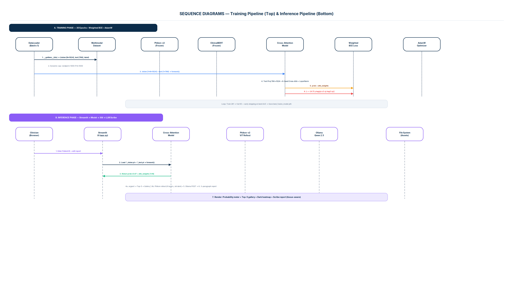
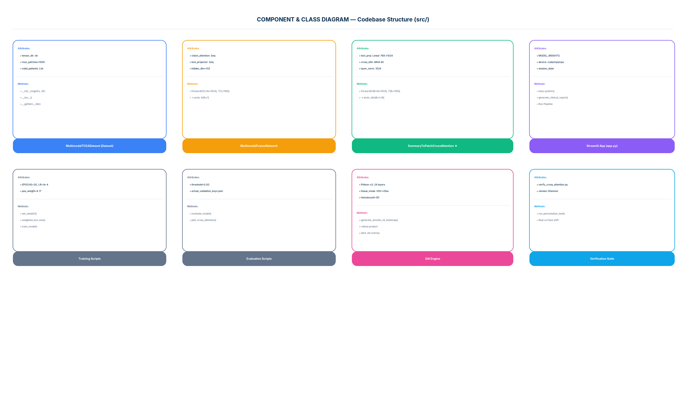
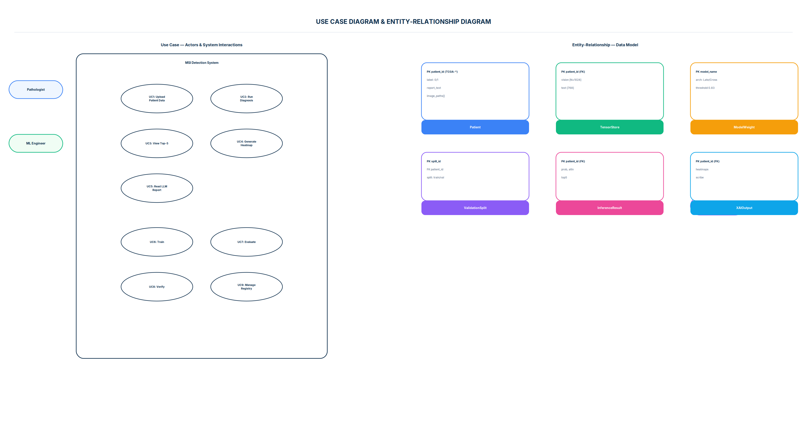
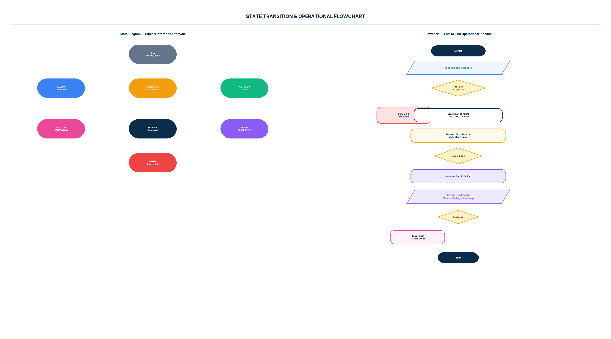

# Architecture & System Design — Multimodal MSI Detection

> **Project:** Multimodal Fusion for Detection of Colorectal Cancer Using ClinicalBERT and Phikon-v2  
> **Versions:** `fusion_model_v1_1.pth` (primary, Cross-Attention) • `late_fusion_model_v1_0.pth` (baseline)

---

## 1. Executive Summary

This framework solves **fast MSI pre-screening** from standard H&E histology + unstructured pathology reports, replacing 7–14 day PCR/IHC/NGS workflows with a **single forward pass** that is **clinician-auditable** via a 3-tier Explainable AI stack.

- **Accuracy (isolated 66-patient validation):** 89.39% • ROC-AUC 0.9150 • MSI F1 0.77 (vs 0.50 baseline)
- **Clinical key:** MSI recall 0.75 vs 0.44 baseline — **catches 2× more MSI cases** at 0.80 precision
- **Novelty:** `SummaryToPatchCrossAttention` — text query (`Q`) searches WSI patch landscape (`K/V`) via 8-head `nn.MultiheadAttention` in a shared 1024-D latent space. Verified by **perturbation test** (real vs noise text → attention ranking physically shifts, proving dynamic text-guided search).

---

## 2. System Architecture — 4-Phase Pipeline


### Phase 1 — Data Curation (`data/`)
- **Source:** Kaggle `tcga_coad_msi_mss_jpg` — 326 patients, 192,314 patches (224×224 @10×, ~1.0 µm/px), Reinhard stain-normalized, Otsu foreground-filtered (>50% background removed).
- **Registry:** `data/patient_registry.json:1` — dict `TCGA-* → {label, class_name, report_text, image_paths, patch_count}`. `label 1=MSI, 0=MSS` (63 MSI / 263 MSS, pos_weight 4.17).
- **Contract:** `results/actual_validation_keys.json` — locks 66 isolated validation IDs (50 MSS / 16 MSI). `multimodal_dataset.py:46` filters `valid_patients` strictly to this set at eval to enforce **zero leakage**.

### Phase 2 — Feature Engineering (Frozen Encoders)
| Modality | Encoder | Params | Output | File |
|----------|---------|--------|--------|------|
| Vision | **Phikon-v2** (DINOv2 ViT-L/16, `owkin/phikon-v2`) | 307M, pretrained 460M histology tiles | `V ∈ ℝ^{N×1024}`, N≤1000, dynamic cap via `torch.randperm` in `multimodal_dataset.py:77` | `data/clean_tensors/*_vision.pt` ([N,1024]) |
| Text | **ClinicalBERT** (BioBERT→MIMIC-III 2M notes) | 110M, WordPiece, max 512 tokens | `T ∈ ℝ^{1×768}` ([CLS] summary) or full sequence `[L×768]` for cross-attn | `data/clean_tensors/*_text.pt` ([1,768]) |

- **Tensor Store:** 653 files (326×2) under `data/clean_tensors/` — frozen, deterministic, CPU/GPU agnostic.
- **Batching:** `batch_size=1` throughout — preserves variable `N` without zero-padding (see `multimodal_dataset.py:92` collate discussion).

### Phase 3 — Fusion & Learning (`src/architectures/`)
Two architectures are implemented; **Cross-Attention is primary** (see §4):

- **Training:** `src/cross_attentiion_train.py:45` & `src/late_fusion_train.py:42` — AdamW (lr 1e-4, wd 1e-4, β1 0.9 β2 0.999), Weighted BCE (pos_weight 4.17), 30 epochs, 80/20 split with `random_split` + `set_seed(42)`. Best checkpoint saved on **val AUC**.
- **Inference thresholds:** Cross-Attention τ=0.83 (conservative, high MSI precision) vs Late-Fusion τ=0.70 / 0.50 (see `cross_attention_eval.py:161` & `late_fusion_eval.py:93`).

### Phase 4 — Inference & XAI (`src/ui/app.py`, `src/generate_*.py`)
- **Macroscopic:** Cross-attention weights → `argsort → Top-5` patches (red-border gallery) — `generate_xai.py:86`.
- **Microscopic:** Phikon-v2 last-6-layer attention rollout → Gaussian blur → Jet overlay + yellow ROI contours — `generate_pixel_xai.py:88`.
- **Linguistic:** Context package `{prob, top5, report_text}` → Ollama `qwen2.5-coder:7b` → 3-paragraph scribe (`src/ui/app.py:61` with offline templated fallback).
- **UI:** Streamlit `src/ui/app.py` — `st.cache_resource` model loader, `st.session_state` persistence, 5-col gallery, histogram, downloadable scribe report.

---

## 3. Data Flow Diagrams


### DFD Level 0 — Context
- **External Entities:** TCGA/Kaggle, Pathologist/Clinician (Browser), Model Registry, Ollama LLM
- **7 Data Flows:** D1 raw JPEG+reports → M1 weights → Q1 patient query → R1 diagnosis+XAI → C1 context → S1 summary → L1 eval metrics

### DFD Level 1 — Decomposed
- **Processes:** 1.0 Ingest/Preprocess → 2.0 Encode Vision → 2.1 Encode Text → 3.0 Fuse/Classify → 4.0 Explain (XAI) → 5.0 Serve (Streamlit)
- **Data Stores:** D1 `patient_registry.json`, D2 `clean_tensors/*.pt`, D3 `models/*.pth`, D4 `actual_validation_keys.json`, D5 XAI outputs

---

## 4. Model Design — Comparative Deep Dive


### 4.1 Late Fusion Baseline — `src/architectures/late_fusion_model.py:5`

```
Vision: V [1×N×1024] --squeeze--> [N×1024]
       → Linear(1024→512)→Tanh→Linear(512→1) → Softmax → A [N×1], Σ=1
       → vision_summary = Aᵀ·H  [1×1024]   (AB-MIL, Ilse et al. 2018)

Text:   T [1×768] → Linear(768→512)→ReLU→Dropout(0.3) → [1×512]

Fusion: fused = cat(vision_summary, text_summary) [1×1536]
       → Linear(1536→256)→ReLU→Dropout(0.3)→Linear(256→1)→Sigmoid → prob
       → threshold 0.70 → MSI/MSS
       ↳ returns (prob, A) for XAI
```

- **Params:** ~1.2M trainable (AB-MIL + projector + MLP). Encoders frozen.
- **Limitation:** **Isolated branches** — text cannot modulate vision; attention static under text perturbation (verified in `eval/verify_late_attention.py`).

### 4.2 Cross-Attention Primary — `src/architectures/cross_attention_fusion.py:4` ★

```
Input:  V [B×N×1024] (vision_seq), T [B×768] (text_summary)
Shape:  T → unsqueeze(1) → [B×1×768], V → unsqueeze(0) if 2-D → [1×N×1024]

① Projection:
    T' = Linear(768→1024)(T)  [B×1×1024]   (Xavier init, trainable, shared space)

② Cross-Attention (nn.MultiheadAttention, 8 heads, batch_first=True):
    Q = T' , K = V , V = V
    CrossAttn(Q,K,V) = softmax(QKᵀ / √1024) · V
                     → attn_output [B×1×1024], attn_weights [B×1×N]

③ Residual + LayerNorm:
    fused = LayerNorm(T' + attn_output)  [B×1×1024]

④ Pool + Classify:
    pooled = fused.squeeze(1)  [B×1024]
    prob = Sequential(Linear(1024→256)→ReLU→Dropout(0.3)→Linear(256→1)→Sigmoid) → [B×1]
    → returns (prob, attn_weights)
    → Decision: MSI if prob ≥ 0.83 else MSS
```

- **Params:** 5,250,561 trainable (projection 786k + MHA 4.2M + LayerNorm 2k + MLP 262k)
- **Why it wins:** Single text query **searches** the patch landscape; attention is **dynamic** — different clinical notes → different patch rankings (JS divergence >0, `eval/verify_cross_attention.py:61`).

### Hyperparameter Rationale — `cross_attentiion_train.py:32` & Report §4.6
- **Weighted BCE:** `L = −[4.17·y·log(p) + (1−y)·log(1−p)]`, clamped `p∈[1e-7,1−1e-7]`, where `w⁺=N_MSS/N_MSI≈4.17` compensates imbalance. **Equilibrium loss ≈4.17** is expected, not failure — proves optimizer balancing scaled MSI gradients.
- **Threshold 0.83:** Sweep 0.30→0.90 chosen for max MSI precision (0.80) while keeping recall ≥0.75 (clinical requirement: avoid false-positive MSI that triggers inappropriate ICI).
- **AdamW over Adam:** Decoupled weight decay stabilizes large projection+MHA layers.

---

## 5. Sequence Diagrams



### Training (30 epochs)
`DataLoader(batch=1)` → `MultimodalTCGADataset.__getitem__` (dynamic cap, `torch.randperm` if N>1000) → `vision[1×N×1024] + text[1×768]` → `SummaryToPatchCrossAttention.forward()` (proj→MHA→LayerNorm→MLP) → `prob+attn` → `Weighted BCE (pos 4.17)` → `loss.backward()` → `AdamW.step()` (frozen encoders untouched) → val loop → best AUC checkpoint.

### Inference (Streamlit)
Browser `patient_id + text edit` → `app.py:load_system()` (cached) → load `*_vision.pt + *_text.pt` → `model(V,T)` → `prob, attn` → `argsort → Top-5 → JPEG gallery` → parallel: `Phikon-v2 rollout heatmap` and `POST Ollama /api/generate → scribe` → render `meter + gallery + heatmap + report`.

---

## 6. Deployment Architecture


| Tier | Component | Tech | Notes |
|------|-----------|------|-------|
| **Client** | Clinician Browser | Chrome/Safari/Edge | No install; HTTPS :8501; patient ID + editable report |
| **App** | Streamlit Server | `src/ui/app.py`, Python 3.10+ | `st.cache_resource`, session_state, device router `cuda→mps→cpu` |
| **Data** | Registry + Tensors + Weights | `patient_registry.json`, `clean_tensors/*.pt`, `models/*.pth` | 326 patients, 653 tensors, ~5–20 MB weights |
| **LLM** | Scribe | Ollama + `qwen2.5-coder:7b` (localhost:11434) | Deterministic prompt; template fallback if offline |
| **Infra** | DevOps | `requirements.txt` (75 pkgs), Docker, `.streamlit/config.toml` | `Dockerfile` included; Streamlit Cloud / HF Spaces ready |

**Startup:**
```bash
streamlit run src/ui/app.py --server.port 8501
# or
docker build -t crc-msi . && docker run -p 8501:8501 crc-msi
```

---

## 7. Component & Class Structure



- `MultimodalTCGADataset(Dataset)` — `__init__`, `__len__`, `__getitem__` (`src/multimodal_dataset.py:7`)
- `MultimodalFusionNetwork(nn.Module)` — AB-MIL + concat MLP (`src/architectures/late_fusion_model.py:5`)
- `SummaryToPatchCrossAttention(nn.Module)` ★ — projection + MHA + LayerNorm + classifier (`src/architectures/cross_attention_fusion.py:4`)
- `Streamlit App` — `load_system()`, `generate_clinical_report()`, pipeline (`src/ui/app.py:31`)
- `Training Scripts` — `cross_attentiion_train.py:45`, `late_fusion_train.py:42`
- `Evaluation` — `cross_attention_eval.py:60`, `late_fusion_eval.py:20`
- `XAI Engine` — `generate_pixel_xai.py:53`, `generate_xai.py:16`
- `Verification` — `eval/verify_cross_attention.py:11`, `eval/tensor_dim_check.py:1`

**Key relations:** Dataset **provides** tensors → both models **evolve** (Late→Cross) → App **inference** → XAI **explains** → Verification **proves**.

---

## 8. Training & Evaluation Pipeline


### Training Loop Details
1. `set_seed(42)` — full reproducibility
2. Registry → verify `.pt` existence → 326 valid
3. 80/20 split → save `actual_validation_keys.json`
4. DataLoader batch=1, shuffle, randperm cap 1000
5. Forward through Cross-Attention
6. Weighted BCE (clamped, pos 4.17)
7. AdamW backward
8. Validate on 65 patients, ROC-AUC, save best
9. Plot loss trajectory (plateau 4.17)

### Evaluation Results (66-patient holdout)

| Metric | Late Fusion (τ=0.70) | Cross-Attention (τ=0.83) ★ | Δ |
|--------|---------------------|---------------------------|-----|
| Accuracy | 81.82% | **89.39%** | +7.57 pp |
| ROC-AUC | 0.8950 | **0.9150** | +0.020 |
| MSI Precision | 0.78 | **0.80** | +0.02 |
| MSI Recall | 0.44 | **0.75** | **+0.31** |
| MSI F1 | 0.50 | **0.77** | **+54%** |
| Macro F1 | 0.69 | **0.85** | +0.16 |

*Cross-Attention catches 12/16 MSI vs 7/16 baseline — critical clinical gain.*

Artifacts: `results/Confusion_Matrix_C.png`, `ROC_Curve_C.png`, `Real_Cross_Attention_Matrix.png`, `Cross_Attention_Model_Evaluation_Report.txt`.

---

## 9. Explainable AI Stack — 3 Tiers


### Tier 1 — Macroscopic: Where did the model look?
`cross_attention_eval.py:48` — intercept `attn_weights[B×1×N]` → average 8 heads → `argsort` descending → Top-5 indices → map via `patient_registry.json:image_paths` → gallery (5-col, red border, score label). `src/ui/app.py:166` implements 5-col wrapping + dynamic slider (5–20).

### Tier 2 — Microscopic: What is inside that patch?
`src/generate_pixel_xai.py:53` — `generate_smooth_vit_heatmap(img_path)`:
- Phikon-v2 ViT-L/16 (24 layers) with `output_attentions=True`
- Stack last 6 layers → layer-mean → head-mean → CLS→patch attention `grid_size=14`
- Normalize → GaussianBlur (5×5 soft, 15×15 ROI) → percentile thresholds 70% (jet) / 80% (contour)
- Render 3-panel: Original | Yellow ROI contours (AA, thickness 4) | Jet overlay (α=0.45)
- Integrated in Streamlit dropdown + manual uploader; also `src/generate_xai.py:92` batch Top-5 reports to `assets/medical_images/XAI_Report_*.png`.

### Tier 3 — Linguistic: What does it mean?
`src/ui/app.py:61` — assembles `{prob, top5, report_text}` → Ollama POST → deterministic prompt (no hallucination) → 3 paragraphs (Summary • Findings • Recommendation). Offline fallback uses templated clinically-grounded text.

### Verification — Perturbation Test (`eval/verify_cross_attention.py:11`)
Real text tensor vs `torch.randn_like` fake → second forward → compare Top-5 + Jensen-Shannon Divergence → plot profile shift. **Late Fusion:** no shift (static). **Cross-Attention:** ranking physically shifts ✔ — proof of text-guided search.

---

## 10. Use Case & Data Model



### Use Cases (10)
UC1 Upload Patient Data • UC2 Run Diagnosis • UC3 View Top-5 Gallery • UC4 Generate Heatmap • UC5 Read LLM Report • UC6 Train/Retrain • UC7 Evaluate (ROC/CM) • UC8 Verify Perturbation • UC9 Manage Registry • UC10 Monitor Loss

Actors: Pathologist, ML Engineer, Clinician, System (Phikon-v2/ClinicalBERT/LLM)

### ER Diagram
`Patient` (PK patient_id) —1:2→ `TensorStore` (vision/text pt) —N:1→ `InferenceResult` (prob, attn, top5) —1:1→ `XAIOutput` (heatmaps, scribe). `Patient` —1:N→ `ValidationSplit` (train/val membership via `actual_validation_keys.json`). `ModelWeight` —1:N→ `InferenceResult`.

---

## 11. State & Flowchart



**States:** IDLE → LOADING → INFERENCING → XAI READY → HEATMAP GENERATING / SCRIBE GENERATING → DISPLAY (success) or ERROR (recoverable, retry).

**Flow:** START → load registry/tensors → patient in registry? → (No: error→await input) / (Yes: load V+T → forward → prob≥0.83? → MSI/MSS → compute confidence + Top-5 + scribe → render dashboard → heatmap requested? → Phikon rollout → END)

---

## 12. Technology Choices & Trade-offs

| Decision | Choice | Why | Trade-off |
|----------|--------|-----|-----------|
| Encoders frozen | Phikon-v2 + ClinicalBERT no grad | 417M params joint fine-tune impractical on <16GB GPU; frozen tensors are deterministic & cacheable | Cannot adapt encoders to TCGA domain shift |
| Batch=1 | No padding | Preserves variable N biology; avoids zero-padding artifacts | Slower training (261 steps/epoch vs batched) but negligible at 326 patients |
| Weighted BCE | pos_weight 4.17 | Fixes MSI recall from 0.44→0.75 without synthetic data | Val loss plateau ~4.17 confuses naive observers; needs report §4.6 explanation |
| τ=0.83 | Conservative | MSI precision 0.80 needed — false MSI triggers costly/ineffective ICI | Slight MSS recall dip 0.96→0.94 (acceptable) |
| 1000 patch cap | Random sample | Covers 224×224 @10× heterogeneity; bounds memory | Long WSI truncated; future: Longformer + GigaPath tiling |
| Ollama local | Qwen 2.5 offline | PHI stays on-prem; no cloud leak; deterministic | Requires `ollama serve` + 4GB model pull; fallback needed |
| Streamlit | vs Flask/FastAPI | Rapid clinical prototyping, native session_state, built-in charts | Not ideal for high-concurrency; migration path to FastAPI+React noted |

---

## 13. File Map (Key Paths)

```
Colorectal_cancer_detect/
├── data/
│   ├── patient_registry.json          # master index (326 patients)
│   ├── clean_tensors/                 # 653 frozen tensors (*_vision.pt, *_text.pt)
│   ├── Download_DataSet.pdf           # Kaggle link & setup
│   └── MSIMUT_JPEG/ MSS_JPEG/         # raw patches (optional, for gallery)
├── src/
│   ├── multimodal_dataset.py:7        # Dataset, dynamic cap, batch=1
│   ├── architectures/
│   │   ├── late_fusion_model.py:5     # AB-MIL baseline
│   │   └── cross_attention_fusion.py:4# Cross-Attention primary ★
│   ├── cross_attentiion_train.py:45   # train (weighted BCE, AdamW)
│   ├── cross_attention_eval.py:60     # eval + ROC/CM/attn matrix
│   ├── late_fusion_train.py:42 / eval.py:20
│   ├── generate_xai.py:16 / generate_pixel_xai.py:53
│   ├── eval/verify_cross_attention.py:11
│   └── ui/app.py:31                   # Streamlit production app ★
├── models/
│   ├── fusion_model_v1_1.pth          # primary (best AUC)
│   └── late_fusion_model_v1_0.pth     # baseline
├── results/
│   ├── actual_validation_keys.json    # data contract (66 IDs)
│   ├── Cross_Attention_Model_Evaluation_Report.txt
│   ├── Confusion_Matrix_C.png / ROC_Curve_C.png
│   └── Real_Cross_Attention_Matrix.png
├── assets/medical_images/             # XAI reports (5 samples)
├── docs/
│   ├── ARCHITECTURE.md (this file)
│   ├── diagrams/01..10_*.png
│   └── generate_diagrams.py           # diagram generator
├── requirements.txt (75 pkgs)
├── Dockerfile / .streamlit/config.toml
└── PB05_Report_8thSem.pdf (89 pp)
```

---

## 14. References

- Kather et al. 2019 — Deep learning MSI prediction (CNN, H&E)
- Filiot et al. (Owkin) 2023/24 — Phikon-v2 (DINOv2 ViT-L/16, 460M)
- Oquab et al. 2023 — DINOv2 self-distillation
- Alsentzer et al. 2019 — ClinicalBERT (MIMIC-III)
- Ilse et al. 2018 — Attention-based MIL
- Dosovitskiy et al. 2020 — ViT

---

*Document generated from codebase inspection + PB05 Report (89 pages). All diagrams are reproducible via `docs/generate_diagrams.py`.*
